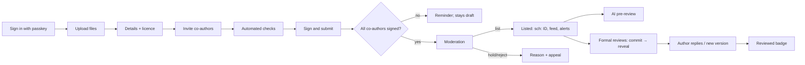

# Scholium — Product Design (UX/UI)

| | |
| --- | --- |
| Product | **Scholium** (formerly working title "OpenResearch") |
| Document | UX/UI design v1.0 |
| Date | 2026-11-14 |
| Companion docs | `PRD.md` (requirements), `tech_architect.md` (system architecture) |

## 1. Design intent

Scholium should feel like a reading room, not a crypto app. Researchers come to read, write and judge papers; the cryptography should be visible only as quiet proof that what they see is real.

The name sets the visual idea: a *scholium* is a note in the margin of a text. The paper sits in the centre; reviews, annotations and proofs live in its margin.

### Principles

1. **The paper comes first.** Reading is the default state of every paper page. Chrome recedes.
2. **Proof without jargon.** Say "Verified" and "Signed by 4 authors", not "CID" or "Merkle root". Details are one click away for those who want them.
3. **No wallet, no gas, no seed phrase.** Sign-in is a passkey. Signing is a button labelled "Sign and submit".
4. **Quality is not popularity.** Formal reviews and discussion are visually separate. No like counts on papers. No leaderboard.
5. **Advisory means advisory.** AI output always carries its label and never uses the colours of human review status.
6. **Every decision shows its reason.** Moderation, badges and retractions link to the record and the policy clause.
7. **Calm under failure.** "Anchor pending" and "2 of 5 replicas" are states, not errors.

## 2. Brand

Summary: delivered assets (each file in docs/brand and where it is used in the app); construction of the mark (page block, text lines, bracket, margin-note strip); light and dark lockups; minimum sizes (mark 16px, lockup 20px tall); clear space (half the mark height); colour usage (accent, paper, ink, dark-mode equivalents from §3); wordmark typography (Source Serif 4 semibold, always lowercase); do/don't (no recolouring, no stretching, no effects, never put the tile on a busy background); keep the existing clearance note.

### Name and voice

- Name: **Scholium**; the wordmark is always lowercase `scholium`.
- Voice: plain, precise, collegial. Short sentences. No hype words ("revolutionary", "trustless").
- ID style: `sch:k3f9-q2xz-7mwd/v3`, monospace, always copyable.

### Delivered assets

The files in `docs/brand` are the source of truth for the brand. Each is used in the app as follows.

| File | What it is | Where it is used in the app |
| --- | --- | --- |
| `docs/brand/scholium-favicon.svg` | 32×32 SVG of the tile mark (accent tile, light page block with text lines and closing bracket) | `apps/web/src/app/icon.svg` (browser tab favicon); geometry source for `BrandMark` variant "tile" |
| `docs/brand/favicon.ico` | Multi-size ICO (16×16, 32×32) | `apps/web/src/app/favicon.ico` |
| `docs/brand/apple-touch-icon.png` | 180×180 PNG tile mark | `apps/web/src/app/apple-icon.png` (home-screen icon) |
| `docs/brand/scholium-favicon-tile.jpeg` | 1024×1024 high-res tile mark | Source for `apps/web/public/brand/icon-192.png`, `icon-512.png` and `icon-maskable-512.png` (web manifest icons) |
| `docs/brand/scholium-logo-light.jpeg` | Light lockup reference (1376×768) | Source for `apps/web/public/brand/scholium-logo-light.png`; reference for the light lockup and `BrandLogo` |
| `docs/brand/scholium-logo-dark.jpeg` | Dark lockup reference (1376×768) | Source for `apps/web/public/brand/scholium-logo-dark.png`; reference for the dark lockup |

The mark is also rendered as inline SVG by `BrandMark` / `BrandLogo` (`apps/web/src/features/ui-kit/brand-mark.tsx`, `brand-logo.tsx`) and used in the global navigation, the sign-in/onboarding/recovery layout, the root not-found and error pages, branded social share images, and the notification email header.

### Construction of the mark

The mark has two parts: a **page block** (an ink-blue rectangle standing in for a page of text) and a **closing bracket** to its right, the "margin note" that gives Scholium its name.

- **Tile variant** (favicon / app icon): a rounded accent square (corner radius 6 px) with the page block and bracket cut out in the paper colour. The page block carries **four text lines**, the last one short, followed by the closing bracket.
- **Glyph variant** (lockup): an accent-filled **page block** with **four light text lines** (the last one short), a thin **margin-note strip** in the margin-note colour between the page block and the accent **closing bracket** to its right.

The margin-note strip is the signature detail: it is the scholium in the margin, the annotation that sits beside the text.

### Light and dark lockups

- **Light lockup**: page block and bracket in accent `#2F4BA0`; text lines in paper `#FBFAF7`; margin-note strip in `#FFF6D6`; wordmark in ink `#1B1D22` on paper `#FBFAF7`.
- **Dark lockup**: page block and bracket in accent `#8FA6F0` (the dark-mode equivalent from §3); text lines in paper `#14151A`; margin-note strip in `#3A3320`; wordmark in ink `#ECEBE6` on paper `#14151A`.

Because every colour is read from the design tokens (`--accent`, `--bg`, `--ink`, `--margin-note`), the mark re-themes automatically between light and dark; no separate dark artwork is needed at runtime.

### Minimum sizes

- **Mark**: never rendered smaller than **16px** (16 px).
- **Lockup**: never shorter than **20px tall**.

### Clear space

Clear space around the mark equals **half the mark height** on all sides. Nothing may intrude into this space.

### Colour usage

Colour roles follow §3 (Colour). The mark uses only these tokens, with their dark-mode equivalents from §3:

| Role | Light | Dark | Use in the mark |
| --- | --- | --- | --- |
| Accent | `#2F4BA0` | `#8FA6F0` | Page block, closing bracket, tile background |
| Paper | `#FBFAF7` | `#14151A` | Text lines cut out of the mark |
| Ink | `#1B1D22` | `#ECEBE6` | Wordmark colour |
| Margin note | `#FFF6D6` | `#3A3320` | Margin-note strip between page and bracket |

No other colour may be used in the mark or tile.

### Wordmark typography

The wordmark is set in **Source Serif 4 semibold**, always lowercase (`scholium`), in the ink colour, with optical spacing so the cap height of the wordmark aligns with the page block. It is never set in any other face, weight, case or colour.

### Do / don't

Do:
- Use the delivered geometry and the token colours exactly.
- Keep the clear space of half the mark height.
- Use the wordmark in Source Serif 4 semibold, always lowercase.

Don't:
- **No recolouring** — do not change any colour of the mark, tile or wordmark.
- **No stretching** — do not distort the aspect ratio of the mark or tile.
- **No effects** — no shadows, gradients, outlines, glows or other decoration.
- **Never put the tile on a busy background** — the tile needs a calm, solid surface.
- Do not separate the margin-note strip from the mark or recolour it independently.

Clearance note: the name passed a web search for conflicting publishing products, but trademark and domain clearance are still required before the brand is used publicly.

## 3. Design tokens

### Colour

| Token | Light | Dark | Use |
| --- | --- | --- | --- |
| `--bg` | `#FBFAF7` | `#14151A` | Page (warm paper) |
| `--surface` | `#FFFFFF` | `#1C1E25` | Cards, margin panel |
| `--ink` | `#1B1D22` | `#ECEBE6` | Body text |
| `--ink-2` | `#5A5F6B` | `#A3A7B2` | Secondary text |
| `--rule` | `#E4E1D9` | `#2C2F38` | Borders, dividers |
| `--accent` | `#2F4BA0` | `#8FA6F0` | Links, primary buttons (scholar's ink blue) |
| `--verified` | `#1F7A54` | `#5CC79A` | Verified, Reviewed |
| `--pending` | `#9A6B00` | `#E0B14A` | Pending, Under review, Contested |
| `--critical` | `#B3312B` | `#F08A84` | Retracted, failed verification |
| `--ai` | `#6B4BA8` | `#B9A2F2` | AI pre-review only |
| `--margin-note` | `#FFF6D6` | `#3A3320` | Annotation highlight |

Rules: text contrast ≥ 4.5:1; status is never colour alone (icon + word always); `--ai` is reserved and never used for human status.

### Typography

| Role | Font | Size / line |
| --- | --- | --- |
| Paper title | Source Serif 4, 600 | 30 / 38 |
| Reading text, abstracts, reviews | Source Serif 4, 400 | 18 / 30, max 72 characters per line |
| UI text | Inter, 400/500 | 15 / 22 |
| Small / meta | Inter, 400 | 13 / 18 |
| IDs, hashes, code | JetBrains Mono | 13 / 18 |
| Math | KaTeX | inherits |

### Space, shape, motion

- 4 px base grid; spacing scale 4, 8, 12, 16, 24, 32, 48, 64.
- Radius 6 px (controls), 10 px (cards). Borders 1 px `--rule`; no drop shadows except the floating annotation popover.
- Motion 150–200 ms ease-out; respect `prefers-reduced-motion`.
- Breakpoints: 640 (phone), 1024 (tablet), 1280 (desktop with margin panel).

## 4. Information architecture

```text
Scholium
├── Home (feed)                  /
│   ├── Latest · Reviewed · Following
│   └── Categories               /c/{category}
├── Search                       /search?q=
├── Paper                        /p/{id}[/v{n}]
│   ├── Read (PDF / HTML)
│   ├── Margin: Reviews · AI pre-review · Discussion · Versions · Files · Proof
│   └── Cite / Export
├── Submit                       /submit        (wizard)
├── Review                       /review/{id}   (rubric form)
├── Dashboard                    /me
│   ├── My papers · Drafts · Consents waiting
│   ├── My reviews · Invitations
│   ├── Credentials · Keys & recovery
│   └── Notifications
├── Profile                      /u/{did or handle}
├── Moderation (tier 4)          /mod
├── Governance                   /gov           (Phase 3)
├── Network                      /network       (nodes, replication, status)
└── Docs · Policies · Verify a file  /verify
```

Global navigation (desktop): logo · Search field · Categories · Submit · notifications · avatar. Mobile: bottom bar with Home, Search, Submit, Inbox, Me.

## 5. Key screens

### 5.1 Home feed

```text
┌──────────────────────────────────────────────────────────────────────────┐
│ scholium     [ Search papers, authors, sch: IDs…            ]  Submit  ◔ │
├──────────────────────────────────────────────────────────────────────────┤
│ Latest | Reviewed | Following            Category: cs.AI ▾   Sort ▾     │
├──────────────────────────────────────────────────────────────────────────┤
│ Can a Meta-Agent Choose the Safer Branch?                                │
│ M. Zhang, A. Okafor, +2 · cs.AI, cs.MA · v2 · 3 days ago                 │
│ An evaluation framework for whether meta-agents can identify safer…      │
│ ✓ Reviewed (3)   ⌥ Code runs   ◇ AI pre-review   💬 8                    │
│──────────────────────────────────────────────────────────────────────────│
│ Sparse Probing of Reward Models                                          │
│ L. Haddad · cs.LG · v1 · 5 hours ago                                     │
│ ○ Preprint       ⌥ Code attached   ◇ AI pre-review pending               │
└──────────────────────────────────────────────────────────────────────────┘
```

- Each row: title (serif), authors, categories, version, age, two-line abstract, status chips.
- No vote counts. Sort options: newest, recently reviewed, recently updated.

### 5.2 Paper page (the core screen)

```text
┌───────────────────────────────────────────────┬──────────────────────────┐
│ ← cs.AI                                        │ ✓ Verified   Details ▸   │
│ Can a Meta-Agent Choose the Safer Branch?      │ sch:k3f9-q2xz-7mwd/v2 ⧉  │
│ Mei Zhang · A. Okafor · R. Silva · J. Tan      │ Anchored 2 Mar 2027      │
│ ✓ Reviewed · v2 of 2 · CC BY 4.0               │ Preserved 5/5 replicas   │
│ [ PDF ] [ HTML ] [ Cite ] [ Download ▾ ]       ├──────────────────────────┤
├───────────────────────────────────────────────┤ Reviews(3) AI Discuss(8) │
│                                                │ Versions Files           │
│  Abstract                                      ├──────────────────────────┤
│  An evaluation framework investigating…        │ Reviewer A · anonymous   │
│                                                │ verified reviewer, cs.AI │
│  1 Introduction                                │ Sound with minor revs    │
│  Multi-agent systems increasingly…  ▍(note)    │ Soundness ●●●●○          │
│                                                │ Evidence  ●●●○○          │
│  [highlighted sentence]────────────────────────┼─▸ "The adversarial       │
│                                                │   baseline is unclear…"  │
│                                                │   ↳ Author reply (v2)    │
│                                                │──────────────────────────│
│                                                │ Reviewer B · Dr. Okafor…│
└───────────────────────────────────────────────┴──────────────────────────┘
```

Layout: reading column (max 720 px) + margin panel (360 px). On tablet/phone the margin becomes a bottom sheet with the same tabs.

Margin tabs:

| Tab | Content |
| --- | --- |
| **Reviews** | Formal reviews as cards: reviewer label, recommendation, rubric dots, expandable report, author replies, review-quality rating. Summary bar at top: median per rubric dimension. |
| **AI pre-review** | Purple-accented panel with a fixed banner "Advisory. Generated by AI agents. Not a peer review." Findings grouped by agent; each shows its evidence link (jumps to the span), confidence, and buttons *Rebut* (authors) / *Confirm* / *Wrong* (reviewers). |
| **Discussion** | Threads; paragraph annotations appear here and as margin markers beside the text. |
| **Versions** | Timeline v1 → vN with change notes, anchor dates, "compare" action. |
| **Files** | PDF, source, code, data with size, licence, scan status, reproduction log. |
| **Proof** | Plain-language checklist (below). |

Status banner variants (full width, above the title): *Retracted* (critical), *Corrected* (pending), *A newer version exists* (neutral), *Content removed for legal reasons* (neutral, with reason category).

### 5.3 Verification detail ("Proof" tab)

```text
✓ Verified in your browser                                 Re-run check
────────────────────────────────────────────────────────────────────────
✓ Signed by all 4 listed authors
✓ Version history is intact (v1 → v2)
✓ Files match what the authors signed (3 files)
✓ Timestamp anchored: 2 Mar 2027 04:00 UTC          View transaction ↗
✓ No retraction or correction on record
◔ Preservation: 5 of 5 replicas across 3 operators   Network details ▸

Technical details ▾
  Version record   bafyrei…q7x2                                   ⧉
  Manifest         bafyrei…m1ka                                   ⧉
  Anchor           chain 8453 · batch 18211 · proof (20 hashes)   ⧉
  Verify offline:  scholium verify sch:k3f9-q2xz-7mwd/v2          ⧉
```

States of the header indicator:

| State | Icon + label | When |
| --- | --- | --- |
| Verified | ✓ green "Verified" | All checks pass, anchored |
| Verified, anchor pending | ◔ amber "Signed · anchor pending" | Signatures valid, not yet anchored |
| Checking | spinner "Checking…" | In progress |
| Cannot verify | ? grey "Could not check" | Offline / proof unavailable; never shown as failure |
| Failed | ✕ red "Verification failed" | Any signature or hash mismatch; content is blurred behind a warning |

### 5.4 Submit wizard

Five steps with a persistent progress rail. Drafts autosave locally and to the node (encrypted).

```text
1 Files ─── 2 Details ─── 3 Authors ─── 4 Checks ─── 5 Sign
```

| Step | Content | Key details |
| --- | --- | --- |
| 1 Files | Drop PDF and/or LaTeX; optional code and data; resumable upload | Shows per-file fingerprint progress; size limits stated up front |
| 2 Details | Title, abstract (pre-filled from the file), categories, licence | Licence picker explains each option in one line and flags journal-compatibility |
| 3 Authors | Add co-authors by ORCID or email; assign CRediT roles; order | Each co-author gets a consent link; status chips: Waiting / Signed / Declined |
| 4 Checks | Live results: file safety, references resolved, similarity, metadata match | Problems are fixable in place; nothing is hidden from the author |
| 5 Sign | Summary card + "Sign and submit" (passkey prompt) | Copy: "You are signing version 1 of this paper. This cannot be edited later; you can publish a new version at any time." |

After submit: a status tracker — Submitted → Co-author consents (2/3) → Moderation (target 48 h) → Listed → AI pre-review.

### 5.5 Formal review form

```text
Reviewing: Can a Meta-Agent Choose the Safer Branch?  · v2
You are reviewing anonymously. Your identity is hidden from authors,
readers and this node. It can be opened only by 3 of 5 integrity
committee members in a misconduct case.        [ Sign with my name instead ]

Conflict check   ✓ No co-authorship in 3 years  ✓ Different institution

Soundness of method        ○ 1  ○ 2  ○ 3  ● 4  ○ 5     Justification ▸ (required)
Evidence for claims        …
Reproducibility            …   [ Open reproduction log ]
Novelty                    …
Clarity                    …
Limitations & ethics       …

Confidence                 ○ Low  ● Medium  ○ High
Recommendation             ( Sound as is | Minor revisions | Major concerns | Fundamentally flawed )

☐ I used AI assistance in writing this review (declared on the report)

[ Save draft ]                                   [ Commit review ]
```

- Split view: paper on the left, form on the right; selecting text offers "Cite in review".
- After commit: "Your review is sealed. It will be revealed with the others when a second review is committed, or on 14 Dec."
- A stylometry hint appears if the reviewer chose anonymity: "Tip: avoid phrases that identify you or your lab."

### 5.6 Dashboard

Cards: *Needs your attention* (consents to sign, review invitations, author replies, moderation outcomes) · *My papers* (status, reviews count, replica health) · *My reviews* (sealed / revealed / awaiting author) · *Credentials* (ORCID, affiliation, reviewer categories, contribution credentials with "Share proof") · *Security* (devices, recovery guardians 3 of 5, last key rotation).

### 5.7 Moderation console (tier 4)

Queue table: paper, category, age, automated signals (similarity %, unresolved references, scan result, new-account flag). Detail view shows the paper beside a decision form: action, policy clause (required select), reason (required), preview of what the author will see. Every decision states: "This decision is a public signed record."

### 5.8 Network page

Public transparency page: nodes with standing, last anchor, probe pass rate; replication summary; recent moderation statistics by clause; incident log.

## 6. Core flows



Onboarding (first run, under 2 minutes): create passkey → link ORCID → pick categories to follow → optional: set recovery guardians (nagged gently until done; required before first submission).

Key recovery: "Lost your device?" → identify by ORCID → guardians receive requests → progress "2 of 3 approvals" → 72-hour safety window with a cancel link sent to all known contacts → new passkey.

## 7. Components

| Component | Notes |
| --- | --- |
| Status chip | Icon + word; variants: Preprint, Under review (n), Reviewed, Contested, Corrected, Retracted |
| Verify badge | Five states (5.3); always opens the Proof tab |
| ID pill | Monospace, copy on click, toast "Copied" |
| Review card | Reviewer label, recommendation, rubric dots, expandable body, replies |
| AI finding card | Purple left border, agent name, evidence link, confidence, actions |
| Margin marker | Small dot in the gutter; count when stacked; opens annotation thread |
| Rubric input | 1–5 radio with required justification textarea |
| Consent tracker | Avatars with Waiting / Signed / Declined |
| Replica meter | "5/5" with segmented bar; tooltip lists operators and jurisdictions |
| Decision banner | Full-width, links to record and policy clause |
| Record link | "View record" opens raw signed JSON in a side sheet |
| Empty states | One sentence + one action (e.g. "No reviews yet. Qualified in cs.AI? Review this paper.") |

## 8. Content and microcopy

| Situation | Copy |
| --- | --- |
| Signing | "Sign and submit" · "You're signing with your passkey. Scholium never sees your key." |
| Anchor pending | "Signed. The public timestamp will be added within the hour." |
| Chain unavailable | "Publishing works as normal. The public timestamp will be added when the network is back." |
| AI banner | "Advisory. Generated by AI agents. Not a peer review." |
| AI integrity finding | "Needs a human check: possible figure reuse (Fig. 3 and Fig. 5)." Never "fraud" or "plagiarism detected". |
| Moderation reject | "Not listed: outside category scope (policy 2.1). You can appeal once." |
| Tombstone | "Content removed for legal reasons on 4 May 2027. The record of its existence remains." |
| Verification failed | "This file does not match what the authors signed. Do not rely on it. Try another node." |

Vocabulary: "paper", "version", "review", "record", "verified", "preserved". Avoid in primary UI: "blockchain", "token", "hash", "CID", "node" (use "server" or "network" unless in technical details).

## 9. Accessibility

- WCAG 2.2 AA. Keyboard access to everything, including annotation creation (select paragraph, press `A`).
- HTML rendition of papers (from LaTeX) is the default for screen readers; PDF is secondary.
- Math exposed as MathML via KaTeX.
- Status never by colour alone; rubric dots have text equivalents ("4 of 5").
- Focus rings 2 px `--accent`; targets ≥ 44 px on touch.
- Reduced-motion and high-contrast modes; text scales to 200% without loss.
- Plain-language summaries of cryptographic states.

## 10. Responsive behaviour

| Width | Layout |
| --- | --- |
| ≥ 1280 | Reading column + fixed margin panel |
| 1024–1279 | Reading column; margin panel as collapsible drawer |
| 640–1023 | Single column; tabs under the title; annotations inline |
| < 640 | Single column; bottom navigation; margin content in a bottom sheet; review form as stepped pages |

Reading on phones uses the HTML rendition by default; PDF opens in the native viewer.

## 11. Trust and safety in the interface

- Anonymous reviewers get a stable per-paper label ("Reviewer A") and a neutral avatar; no join date or activity hints.
- Report / flag is available on every post and review; the reporter sees the outcome.
- Blocking and muting in discussion; no direct messages in Phase 1.
- Rate-limit feedback is explicit ("New accounts can post 20 times a day. 3 left today.").
- Retraction and correction banners appear on every version and in search results and citations exports.

## 12. Usability targets and validation

| Target | Measure |
| --- | --- |
| First submission | Completed in < 10 minutes by 80% of pilot users |
| Account creation | < 60 seconds to a working passkey account |
| Verification comprehension | 90% of testers correctly explain "Verified" vs "anchor pending" |
| AI label comprehension | 95% identify the AI report as advisory, not peer review |
| Key recovery | Completed without support by 80% of testers |
| Review form | Median completion effort not higher than a conference review form |

Validation plan: moderated sessions with 8–10 pilot researchers per round (paper prototype → clickable prototype → beta); instrumented funnels for submit and review; quarterly accessibility audit.

## 13. Deliverables for the design phase

1. Design tokens as CSS variables and a Tailwind theme.
2. Component library (Storybook) covering section 7.
3. High-fidelity screens: feed, paper page (all tabs, all banners), submit wizard, review form, dashboard, moderation console, network page.
4. Prototype of the three critical flows: publish, review, verify.
5. Content style guide (section 8 expanded).
