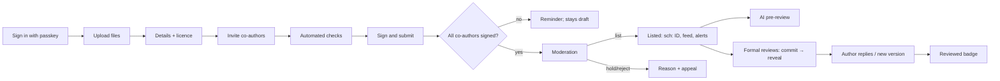

# Scholium — Product Design (UX/UI)

| | |
| --- | --- |
| Product | **Scholium** (formerly working title "OpenResearch") |
| Document | UX/UI design v1.0 |
| Date | 2026-11-14 |
| Companion docs | `PRD.md` (requirements), `tech_architect.md` (system architecture), `homepage/index.html` (design and copy reference for the homepage, §5.9) |

## 1. Design intent

Scholium should feel like a reading room, not a crypto app. Researchers come to read, write and judge papers; the cryptography should be visible only as quiet proof that what they see is real.

The name sets the visual idea: a *scholium* is a note in the margin of a text. The paper sits in the centre; reviews, annotations and proofs live in its margin.

### Principles

1. **The paper comes first.** Reading is the default state of every paper page. Chrome recedes.
2. **Proof without jargon.** Say "Verified" and "Signed by 4 authors", not "CID" or "Merkle root". Details are one click away for those who want them.
3. **No wallet, no gas, no seed phrase.** Sign-in is a passkey. Signing is a button labelled "Sign and submit".
4. **Quality is not popularity.** Formal reviews and discussion are visually separate. No like counts on papers. No leaderboard.
5. **Advisory means advisory.** AI output always carries its label and never uses the colours of human review status.
6. **Every decision shows its reason.** Moderation, badges and retractions link to the record and the policy clause.
7. **Calm under failure.** "Anchor pending" and "2 of 5 replicas" are states, not errors.

## 2. Brand

Summary: delivered assets (each file in docs/brand and where it is used in the app); construction of the mark (page block, text lines, bracket, margin-note strip); light and dark lockups; minimum sizes (mark 16px, lockup 20px tall); clear space (half the mark height); colour usage (accent, paper, ink, dark-mode equivalents from §3); wordmark typography (Source Serif 4 semibold, always lowercase); do/don't (no recolouring, no stretching, no effects, never put the tile on a busy background); the clearance note.

### Name and voice

- Name: **Scholium**; the wordmark is always lowercase `scholium`.
- Voice: plain, precise, collegial. Short sentences. No hype words ("revolutionary", "trustless").
- ID style: `sch:k3f9-q2xz-7mwd/v3`, monospace, always copyable.

### Delivered assets

The files in `docs/brand` are the source of truth for the brand. Each is used in the app as follows.

| File | What it is | Where it is used in the app |
| --- | --- | --- |
| `docs/brand/scholium-favicon.svg` | 32×32 SVG of the tile mark (accent tile, light page block with text lines and closing bracket) | `apps/web/src/app/icon.svg` (browser tab favicon); geometry source for `BrandMark` variant "tile" |
| `docs/brand/favicon.ico` | Multi-size ICO (16×16, 32×32) | `apps/web/src/app/favicon.ico` |
| `docs/brand/apple-touch-icon.png` | 180×180 PNG tile mark | `apps/web/src/app/apple-icon.png` (home-screen icon) |
| `docs/brand/scholium-favicon-tile.jpeg` | 1024×1024 high-res tile mark | Source for `apps/web/public/brand/icon-192.png`, `icon-512.png` and `icon-maskable-512.png` (web manifest icons) |
| `docs/brand/scholium-logo-light.jpeg` | Light lockup reference (1376×768) | Source for `apps/web/public/brand/scholium-logo-light.png`; reference for the light lockup and `BrandLogo` |
| `docs/brand/scholium-logo-dark.jpeg` | Dark lockup reference (1376×768) | Source for `apps/web/public/brand/scholium-logo-dark.png`; reference for the dark lockup |

The mark is also rendered as inline SVG by `BrandMark` / `BrandLogo` (`apps/web/src/features/ui-kit/brand-mark.tsx`, `brand-logo.tsx`) and used in the global navigation, the homepage (its navigation bar, its closing call to action and the animated mark in its name section, §5.9), the sign-in/onboarding/recovery layout, the root not-found and error pages, branded social share images, and the notification email header.

### Construction of the mark

The mark has two parts: a **page block** (an ink-blue rectangle standing in for a page of text) and a **closing bracket** to its right, the "margin note" that gives Scholium its name.

- **Tile variant** (favicon / app icon): a rounded accent square (corner radius 6 px) with the page block and bracket cut out in the paper colour. The page block carries **three text lines**, the last one short, followed by the closing bracket. The tile is exactly `docs/brand/scholium-favicon.svg`; it is not redrawn for the lockup.
- **Glyph variant** (lockup): an accent-filled **page block** with **five light text lines** (the last one about half length), a **margin-note strip** in the margin-note colour between the page block and the accent **closing bracket** to its right.

The glyph and the tile are different drawings. The tile has three lines because five would not survive at 16 px; the glyph has five because that is what the delivered lockup shows. Do not "reconcile" them.

The margin-note strip is the signature detail: it is the scholium in the margin, the annotation that sits beside the text.

#### Glyph proportions

Measured on `docs/brand/scholium-logo-light.jpeg` (1376 × 768; `scholium-logo-dark.jpeg` is the same drawing to within 2 px) and drawn by `BrandMark` on a 52 × 54 grid in which the page block is 36 × 40:

| Part | Reference (px) | As a proportion of the page block | In `BrandMark` (grid units) |
| --- | --- | --- | --- |
| Page block | 104 × 118, square corners | width : height ≈ 0.9 : 1 | 36 × 40, no corner radius |
| Text lines | 5; 4–5 thick, 72 long, 16 in from each side; last 38 long | thickness 0.04 of the height; length 0.69 of the width; last ≈ half the others; centres at 22 / 36 / 50 / 64 / 78 % of the height | 5; 1.6 thick, round ends; 25 long at x = 5.5; last 13 long |
| Closing bracket | 156 tall, strokes 12–13, 38 wide; centred on the page block | height ≈ 1.35 × the page block; stroke ≈ 0.1 × the page width | 54 tall, strokes 4, 13 wide, arm tips 3 right of the page |
| Margin-note strip | fills the bracket's pocket, as tall as the page block | width ≈ 0.25 × the page width | 9 × 40, from the arm tips to the stem |

The tight 52 × 54 box means the SVG is as tall as the bracket. The lockup's height (20 px minimum) is the bracket's height, so the page block itself is 0.74 of it.

### Light and dark lockups

- **Light lockup**: page block and bracket in accent `#2F4BA0`; text lines in paper `#FBFAF7`; margin-note strip in `#FFF6D6`; wordmark in ink `#1B1D22` on paper `#FBFAF7`.
- **Dark lockup**: page block and bracket in accent `#8FA6F0` (the dark-mode equivalent from §3); text lines in paper `#14151A`; margin-note strip in `#3A3320`; wordmark in ink `#ECEBE6` on paper `#14151A`.

Because every colour is read from the design tokens (`--accent`, `--bg`, `--ink`, `--margin-note`), the mark re-themes automatically between light and dark; no separate dark artwork is needed at runtime.

Known difference in dark mode: the delivered `scholium-logo-dark.jpeg` shows no visible strip (its pocket is the page colour), whereas the app paints the strip in `--margin-note`, which is `#3A3320` in dark mode, as listed above. The strip is part of the mark in both themes; it is a muted brown band on dark.

#### Lockup layout

The wordmark is aligned to the mark by **baseline**, not centred, with these proportions of the lockup's height (the bracket's height, `--brand-mark-height`), all measured on the light lockup:

| Measure | Proportion | Notes |
| --- | --- | --- |
| Gap, bracket's right edge to the wordmark's ink | 0.30 | The CSS gap is 0.26; the serif "s" supplies the rest as side bearing |
| Wordmark x-height | 0.46 (0.61 of the page block) | Set with `font-size-adjust`, so a fallback serif keeps it |
| Wordmark baseline above the lockup's bottom edge | 0.205 | 0.11 of the page block's height above the block's bottom edge |
| Wordmark ascenders | reach about the top of the page block | |

The mark inside the lockup carries no clear-space margins of its own: clear space belongs to the lockup as a whole. Putting the mark's half-height margin between the mark and the wordmark is what once pushed the wordmark about 0.75 mark-heights away.

The social share cards draw the same glyph (`brand-card.tsx` keeps a copy with the colours resolved, and a test compares the two shape for shape). Their wordmark layout is tuned separately for the card renderer.

### Minimum sizes

- **Mark**: never rendered smaller than **16px** (16 px).
- **Lockup**: never shorter than **20px tall**.

### Clear space

Clear space around the mark equals **half the mark height** on all sides. Nothing may intrude into this space.

### Colour usage

Colour roles follow §3 (Colour). The mark uses only these tokens, with their dark-mode equivalents from §3:

| Role | Light | Dark | Use in the mark |
| --- | --- | --- | --- |
| Accent | `#2F4BA0` | `#8FA6F0` | Page block, closing bracket, tile background |
| Paper | `#FBFAF7` | `#14151A` | Text lines cut out of the mark |
| Ink | `#1B1D22` | `#ECEBE6` | Wordmark colour |
| Margin note | `#FFF6D6` | `#3A3320` | Margin-note strip between page and bracket |

No other colour may be used in the mark or tile.

### Wordmark typography

The wordmark is set in **Source Serif 4 semibold**, always lowercase (`scholium`), in the ink colour, set at the lockup's height and not tracked in, so that its ascenders reach about the top of the page block (see Lockup layout). It is never set in any other face, weight, case or colour.

### Do / don't

Do:
- Use the delivered geometry and the token colours exactly.
- Keep the clear space of half the mark height.
- Use the wordmark in Source Serif 4 semibold, always lowercase.

Don't:
- **No recolouring** — do not change any colour of the mark, tile or wordmark.
- **No stretching** — do not distort the aspect ratio of the mark or tile.
- **No effects** — no shadows, gradients, outlines, glows or other decoration.
- **Never put the tile on a busy background** — the tile needs a calm, solid surface.
- Do not separate the margin-note strip from the mark or recolour it independently.

Clearance note: the name and the domain were confirmed clear on 20 November 2026, so the brand can be used publicly.

## 3. Design tokens

### Colour

| Token | Light | Dark | Use |
| --- | --- | --- | --- |
| `--bg` | `#FBFAF7` | `#14151A` | Page (warm paper) |
| `--surface` | `#FFFFFF` | `#1C1E25` | Cards, margin panel |
| `--ink` | `#1B1D22` | `#ECEBE6` | Body text |
| `--ink-2` | `#5A5F6B` | `#A3A7B2` | Secondary text |
| `--rule` | `#E4E1D9` | `#2C2F38` | Borders, dividers |
| `--accent` | `#2F4BA0` | `#8FA6F0` | Links, primary buttons (scholar's ink blue) |
| `--verified` | `#1F7A54` | `#5CC79A` | Verified, Reviewed |
| `--pending` | `#9A6B00` | `#E0B14A` | Pending, Under review, Contested |
| `--critical` | `#B3312B` | `#F08A84` | Retracted, failed verification |
| `--ai` | `#6B4BA8` | `#B9A2F2` | AI pre-review only |
| `--margin-note` | `#FFF6D6` | `#3A3320` | Annotation highlight |

Rules: text contrast ≥ 4.5:1; status is never colour alone (icon + word always); `--ai` is reserved and never used for human status.

Homepage tokens. The homepage (§5.9) needs a few roles the table above lacks. They are defined in `apps/web/src/styles/tokens.css` for light, dark and forced dark (`data-theme="dark"`), and the homepage reads every colour from a token, never from a hex literal.

| Token | Light | Dark | Use |
| --- | --- | --- | --- |
| `--bg-2` | `#F3F1EA` | `#101116` | Alternate section background |
| `--line` | `#ECE9E1` | `#2A2D35` | Skeleton text lines in the illustrated paper |
| `--margin-note-strong` | `#F2D77A` | `#8C7330` | Stronger margin-note tone (the highlight's underline) |
| `--glass-tint` | `rgba(251, 250, 247, 0.72)` | `rgba(28, 30, 37, 0.66)` | Liquid Glass fill |
| `--glass-hi` | `rgba(255, 255, 255, 0.7)` | `rgba(255, 255, 255, 0.12)` | Liquid Glass top highlight |

A hairline colour (`--hairline`) and three soft shadow tokens (`--shadow-card`, `--shadow-float`, `--shadow-glass`) come with them for the homepage's cards and floating surfaces; §5.9 says where shadows are allowed.

### Typography

| Role | Font | Size / line |
| --- | --- | --- |
| Paper title | Source Serif 4, 600 | 30 / 38 |
| Reading text, abstracts, reviews | Source Serif 4, 400 | 18 / 30, max 72 characters per line |
| UI text | Inter, 400/500 | 15 / 22 |
| Small / meta | Inter, 400 | 13 / 18 |
| IDs, hashes, code | JetBrains Mono | 13 / 18 |
| Math | KaTeX | inherits |

### Space, shape, motion

- 4 px base grid; spacing scale 4, 8, 12, 16, 24, 32, 48, 64.
- Radius 6 px (controls), 10 px (cards). Borders 1 px `--rule`; no drop shadows except the floating annotation popover (and, on the homepage only, its cards and floating surfaces, §5.9).
- Motion 150–200 ms ease-out; respect `prefers-reduced-motion`. This governs every app screen; the homepage is a presentation page with its own motion rules (§5.9).
- Breakpoints: 640 (phone), 1024 (tablet), 1280 (desktop with margin panel).

## 4. Information architecture

```text
Scholium
├── Home (public front door)     /              (homepage, §5.9)
├── Papers (feed)                /papers
│   ├── Latest · Reviewed · Following
│   └── Categories               /c/{category}
├── Search                       /search?q=
├── Paper                        /p/{id}[/v{n}]
│   ├── Read (PDF / HTML)
│   ├── Margin: Reviews · AI pre-review · Discussion · Versions · Files · Proof
│   └── Cite / Export
├── Submit                       /submit        (wizard)
├── Review                       /review/{id}   (rubric form)
├── Dashboard                    /me
│   ├── My papers · Drafts · Consents waiting
│   ├── My reviews · Invitations
│   ├── Credentials · Keys & recovery
│   └── Notifications
├── Profile                      /u/{did or handle}
├── Moderation (tier 4)          /mod
├── Governance                   /gov           (Phase 3)
├── Network                      /network       (nodes, replication, status)
├── Docs · Policies · Verify a file  /verify
└── For crawlers                 /robots.txt · /sitemap.xml · /llms.txt   (§5.9)
```

Home and Papers. `/` is the public front door: a static page that tells a first-time visitor what Scholium is (§5.9). The paper feed (§5.1) lives at `/papers`, with its tabs, category filter and sort unchanged, and the category pages stay at `/c/{category}`.

Legacy feed links keep working. The feed's query parameters moved with it, so a request for `/` that carries any of `?tab=`, `?category=` or `?sort=` is redirected permanently (HTTP 308) to `/papers` with the same query string: `/?tab=reviewed` goes to `/papers?tab=reviewed`, `/?category=cs.AI` to `/papers?category=cs.AI`, and `/?sort=recently_reviewed` to `/papers?sort=recently_reviewed`. A bare `/` is not redirected; it is the homepage.

Global navigation (desktop): logo (links to `/papers`; its accessible name stays "Scholium home") · Search field · Categories · Submit · notifications · avatar. Mobile: bottom bar with Home (links to `/papers`), Search, Submit, Inbox, Me. The homepage shows neither: it has its own navigation bar (§5.9).

Where "home" points after an action: finishing onboarding and the email-verification continue link land on `/papers`; signing out and the Home buttons on the not-found and error pages go to `/`; the installed web app (the manifest's start URL) opens on `/papers`.

## 5. Key screens

### 5.1 Papers feed

The feed is served at `/papers` (§4; `/` is the homepage, §5.9). Its tabs, category filter, sort and data are as sketched here; only its address changed.

```text
┌──────────────────────────────────────────────────────────────────────────┐
│ scholium     [ Search papers, authors, sch: IDs…            ]  Submit  ◔ │
├──────────────────────────────────────────────────────────────────────────┤
│ Latest | Reviewed | Following            Category: cs.AI ▾   Sort ▾     │
├──────────────────────────────────────────────────────────────────────────┤
│ Can a Meta-Agent Choose the Safer Branch?                                │
│ M. Zhang, A. Okafor, +2 · cs.AI, cs.MA · v2 · 3 days ago                 │
│ An evaluation framework for whether meta-agents can identify safer…      │
│ ✓ Reviewed (3)   ⌥ Code runs   ◇ AI pre-review   💬 8                    │
│──────────────────────────────────────────────────────────────────────────│
│ Sparse Probing of Reward Models                                          │
│ L. Haddad · cs.LG · v1 · 5 hours ago                                     │
│ ○ Preprint       ⌥ Code attached   ◇ AI pre-review pending               │
└──────────────────────────────────────────────────────────────────────────┘
```

- Each row: title (serif), authors, categories, version, age, two-line abstract, status chips.
- No vote counts. Sort options: newest, recently reviewed, recently updated.

### 5.2 Paper page (the core screen)

```text
┌───────────────────────────────────────────────┬──────────────────────────┐
│ ← cs.AI                                        │ ✓ Verified   Details ▸   │
│ Can a Meta-Agent Choose the Safer Branch?      │ sch:k3f9-q2xz-7mwd/v2 ⧉  │
│ Mei Zhang · A. Okafor · R. Silva · J. Tan      │ Anchored 2 Mar 2027      │
│ ✓ Reviewed · v2 of 2 · CC BY 4.0               │ Preserved 5/5 replicas   │
│ [ PDF ] [ HTML ] [ Cite ] [ Download ▾ ]       ├──────────────────────────┤
├───────────────────────────────────────────────┤ Reviews(3) AI Discuss(8) │
│                                                │ Versions Files           │
│  Abstract                                      ├──────────────────────────┤
│  An evaluation framework investigating…        │ Reviewer A · anonymous   │
│                                                │ verified reviewer, cs.AI │
│  1 Introduction                                │ Sound with minor revs    │
│  Multi-agent systems increasingly…  ▍(note)    │ Soundness ●●●●○          │
│                                                │ Evidence  ●●●○○          │
│  [highlighted sentence]────────────────────────┼─▸ "The adversarial       │
│                                                │   baseline is unclear…"  │
│                                                │   ↳ Author reply (v2)    │
│                                                │──────────────────────────│
│                                                │ Reviewer B · Dr. Okafor…│
└───────────────────────────────────────────────┴──────────────────────────┘
```

Layout: reading column (max 720 px) + margin panel (360 px). On tablet/phone the margin becomes a bottom sheet with the same tabs.

Margin tabs:

| Tab | Content |
| --- | --- |
| **Reviews** | Formal reviews as cards: reviewer label, recommendation, rubric dots, expandable report, author replies, review-quality rating. Summary bar at top: median per rubric dimension. |
| **AI pre-review** | Purple-accented panel with a fixed banner "Advisory. Generated by AI agents. Not a peer review." Findings grouped by agent; each shows its evidence link (jumps to the span), confidence, and buttons *Rebut* (authors) / *Confirm* / *Wrong* (reviewers). |
| **Discussion** | Threads; paragraph annotations appear here and as margin markers beside the text. |
| **Versions** | Timeline v1 → vN with change notes, anchor dates, "compare" action. |
| **Files** | PDF, source, code, data with size, licence, scan status, reproduction log. |
| **Proof** | Plain-language checklist (below). |

Status banner variants (full width, above the title): *Retracted* (critical), *Corrected* (pending), *A newer version exists* (neutral), *Content removed for legal reasons* (neutral, with reason category).

### 5.3 Verification detail ("Proof" tab)

```text
✓ Verified in your browser                                 Re-run check
────────────────────────────────────────────────────────────────────────
✓ Signed by all 4 listed authors
✓ Version history is intact (v1 → v2)
✓ Files match what the authors signed (3 files)
✓ Timestamp anchored: 2 Mar 2027 04:00 UTC          View transaction ↗
✓ No retraction or correction on record
◔ Preservation: 5 of 5 replicas across 3 operators   Network details ▸

Technical details ▾
  Version record   bafyrei…q7x2                                   ⧉
  Manifest         bafyrei…m1ka                                   ⧉
  Anchor           chain 8453 · batch 18211 · proof (20 hashes)   ⧉
  Verify offline:  scholium verify sch:k3f9-q2xz-7mwd/v2          ⧉
```

States of the header indicator:

| State | Icon + label | When |
| --- | --- | --- |
| Verified | ✓ green "Verified" | All checks pass, anchored |
| Verified, anchor pending | ◔ amber "Signed · anchor pending" | Signatures valid, not yet anchored |
| Checking | spinner "Checking…" | In progress |
| Cannot verify | ? grey "Could not check" | Offline / proof unavailable; never shown as failure |
| Failed | ✕ red "Verification failed" | Any signature or hash mismatch; content is blurred behind a warning |

### 5.4 Submit wizard

Five steps with a persistent progress rail. Drafts autosave locally and to the node (encrypted).

```text
1 Files ─── 2 Details ─── 3 Authors ─── 4 Checks ─── 5 Sign
```

| Step | Content | Key details |
| --- | --- | --- |
| 1 Files | Drop PDF and/or LaTeX; optional code and data; resumable upload | Shows per-file fingerprint progress; size limits stated up front |
| 2 Details | Title, abstract (pre-filled from the file), categories, licence | Licence picker explains each option in one line and flags journal-compatibility |
| 3 Authors | Add co-authors by ORCID or email; assign CRediT roles; order | Each co-author gets a consent link; status chips: Waiting / Signed / Declined |
| 4 Checks | Live results: file safety, references resolved, similarity, metadata match | Problems are fixable in place; nothing is hidden from the author |
| 5 Sign | Summary card + "Sign and submit" (passkey prompt) | Copy: "You are signing version 1 of this paper. This cannot be edited later; you can publish a new version at any time." |

After submit: a status tracker — Submitted → Co-author consents (2/3) → Moderation (target 48 h) → Listed → AI pre-review.

### 5.5 Formal review form

```text
Reviewing: Can a Meta-Agent Choose the Safer Branch?  · v2
You are reviewing anonymously. Your identity is hidden from authors,
readers and this node. It can be opened only by 3 of 5 integrity
committee members in a misconduct case.        [ Sign with my name instead ]

Conflict check   ✓ No co-authorship in 3 years  ✓ Different institution

Soundness of method        ○ 1  ○ 2  ○ 3  ● 4  ○ 5     Justification ▸ (required)
Evidence for claims        …
Reproducibility            …   [ Open reproduction log ]
Novelty                    …
Clarity                    …
Limitations & ethics       …

Confidence                 ○ Low  ● Medium  ○ High
Recommendation             ( Sound as is | Minor revisions | Major concerns | Fundamentally flawed )

☐ I used AI assistance in writing this review (declared on the report)

[ Save draft ]                                   [ Commit review ]
```

- Split view: paper on the left, form on the right; selecting text offers "Cite in review".
- After commit: "Your review is sealed. It will be revealed with the others when a second review is committed, or on 14 Dec."
- A stylometry hint appears if the reviewer chose anonymity: "Tip: avoid phrases that identify you or your lab."

### 5.6 Dashboard

Cards: *Needs your attention* (consents to sign, review invitations, author replies, moderation outcomes) · *My papers* (status, reviews count, replica health) · *My reviews* (sealed / revealed / awaiting author) · *Credentials* (ORCID, affiliation, reviewer categories, contribution credentials with "Share proof") · *Security* (devices, recovery guardians 3 of 5, last key rotation).

### 5.7 Moderation console (tier 4)

Queue table: paper, category, age, automated signals (similarity %, unresolved references, scan result, new-account flag). Detail view shows the paper beside a decision form: action, policy clause (required select), reason (required), preview of what the author will see. Every decision states: "This decision is a public signed record."

### 5.8 Network page

Public transparency page: nodes with standing, last anchor, probe pass rate; replication summary; recent moderation statistics by clause; incident log.

### 5.9 Homepage and GEO surfaces

`/` is the public front door. A visitor who has never heard of Scholium should learn within one scroll what it is, how it differs from a preprint server, and how to start. Signed-in people can use it too, but the working app starts at `/papers` (§4).

**Design and copy reference.** `docs/homepage/index.html` is a complete static page that is the design and copy reference. The app reproduces its copy word for word and follows its layout and motion; this section does not repeat the copy. Where the reference conflicts with this document (the brand rules in §2, the tokens in §3) this document wins: its hex values map to tokens, its Google Fonts link is replaced by the self-hosted `apps/web/src/styles/fonts.css`, and its illustrative absolute URLs are replaced by `resolveSiteUrl()`. The reference and `docs/brand` are source material and are not edited by the app's build.

```text
┌──────────────────────────────────────────────────────────────────────────┐
│ scholium     Provenance  Open review  AI pre-review  Verify  FAQ         │
│                                          Sign in    [ Submit a paper ]   │
├──────────────────────────────────────────────────────────────────────────┤
│ ✓ Signed, open preprints and peer review                                 │
│                                                                          │
│ The preprint, signed.            ┌──────────────────┐  ┌───────────────┐ │
│ The review, open.                │ ✓ Reviewed  v3   │  │ reader's note │ │
│ The record, kept.                │ title · authors  │  │ formal review │ │
│                                  │ abstract, figure │  │ AI finding    │ │
│ lead paragraph                   │ ✓ Verified · …   │  └───────────────┘ │
│                                  └──────────────────┘                    │
│ [ Submit a paper ] [ Browse papers → ]                                   │
│ Sign in with a passkey and your ORCID iD. Your key never leaves…         │
├──────────────────────────────────────────────────────────────────────────┤
│ Free · CC BY 4.0 · No token, no paywall · Verifies offline               │
└──────────────────────────────────────────────────────────────────────────┘
```

#### Sections, in order

| # | Section | Anchor | What it shows |
| --- | --- | --- | --- |
| 1 | Hero | `#top` | The three-line headline, the lead, the calls to action (Submit a paper to `/submit`, Browse papers to `/papers`) and the passkey fine print. Beside them an illustrated paper page with its margin: a reader's note on a highlighted sentence, a formal review with rubric pips, an AI pre-review finding, and a badge that checks signatures and then reads Verified |
| 2 | Facts strip | | Four short facts: free to read and publish, CC BY 4.0 by default, no token and no paywall, verifies offline |
| 3 | Why Scholium | | One statement paragraph whose words ink in as it scrolls through the viewport |
| 4 | Provenance | `#signed` | A chain of three versions and an interactive tamper demo ("Change one byte in v2" breaks the chain and flips the verdict to failed; "Restore v2" puts it back); three points (your key stays yours, every author agrees, a stable ID to cite); the five status chips (Preprint, Under review, Reviewed, Corrected, Retracted) |
| 5 | Open review | `#review` | A grid of tiles: the rubric as an example, sealed reports that open together, anonymous but accountable reviewers, author replies, discussion |
| 6 | AI pre-review | `#ai` | An example advisory panel with the fixed banner from §5.2 and three findings with evidence links and confidence |
| 7 | Verify | `#verify` | A dark band: an example `scholium verify` run, three link cards (`/verify`, `/papers`, `/network`) and a note labelled Planned |
| 8 | Who it's for | `#who` | Tabs for Authors, Reviewers, Readers and Libraries; each panel has its copy and one call to action |
| 9 | How it works | `#how` | Four numbered steps joined by connector lines |
| 10 | Compare | `#compare` | A table of a typical preprint server against Scholium, seven rows |
| 11 | Principles | `#principles` | Four cards: what Scholium will not do |
| 12 | Name | `#name` | The animated brand mark beside a dictionary entry for "scholium" |
| 13 | FAQ | `#faq` | An "at a glance" card and the eleven questions, each a native `details` element |
| 14 | Final call to action | | The logo, the closing line, and the two calls to action again |

The homepage adds no footer of its own: the root layout's site footer follows the page. The tabs in section 8 and the questions in section 13 are the only widgets that hide content, and only client code hides it (see "Works without JavaScript").

#### Navigation

The homepage has its own bar (`HomeNav`), not the global navigation or the mobile bottom bar. It is sticky and 60 px tall, with the logo lockup (links to `#top`), in-page links to Provenance, Open review, AI pre-review, Verify and FAQ (hidden under 920 px), and two actions that follow the session:

| Session | Actions |
| --- | --- |
| Signed out | Sign in (`/signin`) and a filled Submit a paper (`/submit`) |
| Signed in | Browse papers (`/papers`) and Your dashboard (`/me`) |

The session token lives in browser storage, so the server cannot know who is signed in. The server renders the signed-out actions and the browser swaps them after it has read the session. The bar is transparent at the top of the page and becomes glass once the page has scrolled more than 8 px.

#### Content and scope rules

- **Static and self-contained.** The page is prerendered and makes no API call and no request to another origin. Fonts are self-hosted; icons and illustrations are inline SVG; there are no raster images; no animation library is used. The HTML document stays under 150 KB uncompressed, and the `h1` is in the first response.
- **Works without JavaScript.** Every word is in the server-rendered HTML and visible with scripts off, and to crawlers. An inline script in the home layout sets `data-home-js` on `html` before first paint; the hidden start states of the animations exist only under `html[data-home-js]`. The four role panels are all in the HTML; only client code hides the inactive three.
- **Only what Phase 1 does today.** The copy claims nothing the product does not do yet. Public timestamp anchoring, DOIs and independent library nodes are labelled Planned. Voice follows §2: plain, precise, collegial, no hype words.
- **Colour is a token.** No hex literal appears in the homepage's components or CSS. The roles it adds are in §3 (Homepage tokens). `--ai` appears only in the AI pre-review section; status is icon plus word, as everywhere (§3).
- **The logo is the delivered mark.** It is drawn only by `BrandLogo` and `BrandMark`, with the delivered geometry and token colours and without shadows, gradients, glows or recolouring (§2). The navigation bar and the closing call to action use `BrandLogo`. The name section uses `BrandMark` with its `animated` option, which only adds part class names (page, line, strip, bracket) so the parts can animate in; the finished mark is the delivered mark, and without the option the output is unchanged.
- **Elevation is a homepage-only exception.** §3 allows a drop shadow only on the annotation popover. The homepage is a presentation page: its cards and floating surfaces (the glass navigation bar once scrolled, the hero's paper and margin cards, the tiles, panels, tables and the FAQ's at-a-glance card) sit on the page with a half-pixel `--hairline` ring and one of three soft shadows (`--shadow-card`, `--shadow-float`, `--shadow-glass`). The shadows are tokens, so they re-theme with the rest. The exception stops at the homepage: app screens keep the §3 rule, and the logo never casts a shadow (§2).
- **Its own breakpoints.** Each section reflows at the width where its layout stops fitting (navigation links hide under 920 px; the hero's margin cards stack under the paper, the AI split and the how-it-works steps go vertical under 900 px; the version chain stacks under 860 px; the compare table becomes labelled rows under 720 px), instead of the §10 breakpoints, which describe app screens. There is no horizontal scroll at 375 px.

#### Motion

The homepage is a presentation page, so it moves more than the app does. The 150–200 ms ease-out rule in §3 still governs every app screen; the rules below apply to the homepage only.

- **Springs come in two forms.** Entrances and state changes are CSS animations and transitions whose easing is a spring curve written with CSS `linear()` (two curves, both with a 0.5 s response: one lightly underdamped with a small overshoot, one critically damped with none). Where `linear()` is unsupported the easing falls back to `cubic-bezier(0.23, 1, 0.32, 1)`. Motion that follows the pointer and must stay interruptible is a `Spring` object from `features/home/spring.ts`: it takes a response (seconds) and a damping ratio (1 means no overshoot), integrates with substeps, can be **retargeted mid-flight** (it carries on from the live value and velocity, so a reversed gesture has no jump) and reports when it has settled. Two things use it: the hero stage's tilt toward the pointer (at most 4° around y and 3° around x, only on a fine pointer with the window wider than 900 px) and the indicator of the Who it's for tabs, which slides and resizes between tabs (moved with `transform`, not by animating `left` or `width`).
- **Transform and opacity only.** Movement and entrances animate `transform` and `opacity`; things that grow (text-line skeletons, bars, the brand mark's lines) use `scale`. The two exceptions are the hero highlight's `background-size` sweep and the drawing of SVG strokes with `stroke-dashoffset` (the figure's curves, the badge's check mark, the connector lines). Two in-place reveals are progressive enhancements rather than movement: the FAQ answers open with an animated height only where `::details-content` and `interpolate-size` are supported (instantly elsewhere), and the terminal's command types in with a stepped width. A state colour (the statement words inking in, a verdict turning red) crossfades briefly; it does not move anything.
- **Choreography.** On load, the headline lines rise from behind a mask with a stagger, the paper card rises, its skeleton lines grow, the highlight sweeps, the figure's curves draw, the margin cards slide in on a spring, and the badge's check draws. Further down, one shared `IntersectionObserver` (in `reveal.tsx`) marks each block as it comes into view, once, and its entrance plays then. Small responses to input: the arrow on Browse papers nudges on hover, link cards lift on hover and press in on pointer-down, an FAQ plus turns 45° when its question is open, and the tamper demo shakes the changed version once.
- **Interruptible.** Input-driven motion can be grabbed and reversed at any moment; nothing blocks input until an animation finishes.

#### Accessibility, preferences and contrast

- **`prefers-reduced-motion: reduce`.** All motion becomes an instant change or a short crossfade of opacity (0.3 s at most). Scroll reveals lose their translation; the "Checking signatures…" state is skipped and the badge reads Verified at once; every headline line is visible immediately; the statement is fully inked; the stage does not tilt.
- **`prefers-reduced-transparency: reduce`.** Glass becomes solid `--surface`: no tint, no blur.
- **`prefers-contrast: more`.** Glass, cards, tiles, panels, the tamper demo and the illustrated paper get a 1 px `--ink` border, and the statement is fully inked. Browsers without `backdrop-filter` get a near-opaque `--surface` instead of glass.
- **Contrast.** Text meets 4.5:1 (§3), including text on glass, whatever scrolls beneath it; a glass tint too thin to guarantee that is not acceptable. The Verify band sets `data-theme="dark"` on its own element, so it uses the dark tokens in both themes.
- **Controls.** Every control has a visible 2 px `--accent` focus ring and, on touch, a target of at least 44 px (§9). The Who it's for tabs follow the WAI-ARIA tabs pattern: Left and Right arrows, Home and End move focus and selection, and only the selected tab is in the tab order. The tamper button reports `aria-pressed` and the verdict is a live region.
- **Illustrations have text equivalents.** The hero stage is `aria-hidden` and described by a screen-reader-only caption; the example rubric and the example terminal are `role="img"` with a full text label.
- **Structure.** One `h1`; each section is labelled by its heading; the compare table is a real table with a caption and row headers.

#### GEO surfaces

Generative-engine optimisation means making the site legible to search and answer engines so they can identify Scholium and cite its papers correctly. It adds machine-readable surfaces and no hidden text: structured data repeats only what a visitor can see. Every absolute URL on these surfaces comes from `resolveSiteUrl()` (`apps/web/src/app/site-metadata.ts`, from `NEXT_PUBLIC_SITE_URL`); no domain is hard-coded, so staging never advertises production URLs. JSON is serialised with every less-than sign escaped, so no string can close its `script` element.

| Surface | Where | What it carries |
| --- | --- | --- |
| Homepage metadata | `/` | The absolute title "Scholium — signed, open preprints and peer review" (without the "· Scholium" suffix the other pages get), the description, a canonical link for `/`, and Open Graph and Twitter large-image cards that use the existing `/opengraph-image` |
| Homepage JSON-LD | `/` | One `application/ld+json` `@graph`: `Organization` (name, URL, 512 px logo), `WebSite` (with a `SearchAction` that targets `/search?q={search_term_string}`), `WebPage`, `WebApplication` (free, an offer at price 0, the feature list), a `DefinedTerm` for "scholium", and a `FAQPage` built from the same data as the visible FAQ, so its questions and answers are always the visible ones |
| Paper-page citation tags | `/p/{id}`, `/p/{id}/v{n}` | Highwire Press tags for scholarly indexers: `citation_title`; one `citation_author` per author, in author order; `citation_publication_date` and `citation_online_date` (the version's listed date, `YYYY/MM/DD`); `citation_abstract`; `citation_pdf_url` when the version has a public PDF; `citation_publisher` "Scholium"; `citation_language` "en". Also a canonical link: `/p/{id}` for the newest version and `/p/{id}/v{n}` for a version page |
| Paper-page `ScholarlyArticle` | `/p/{id}`, `/p/{id}/v{n}` | One JSON-LD block: headline, abstract, authors as an ordered list of `Person` (with an ORCID `sameAs` only where the profile shows it publicly), dates, the `sch:` ID as an identifier, URL, licence, free access, version, publisher, and `creativeWorkStatus` set to the paper's status word (Preprint, Under review, Reviewed, Corrected or Retracted; a retraction is never omitted from the structured data) |
| `robots.txt` | `/robots.txt` | In production: all crawlers are allowed; AI crawlers (GPTBot, OAI-SearchBot, ChatGPT-User, ClaudeBot, Claude-SearchBot, Claude-User, PerplexityBot, Perplexity-User, Google-Extended, Applebot-Extended) are named explicitly with the same rules, so the welcome is visible and deliberate; private paths (`/me`, `/mod`, `/consent/`, `/review/`, `/onboarding`, `/recover`, `/verify-email`, `/ui-kit`) are disallowed; the sitemap is linked. In every other environment (development, staging, test) every crawler is disallowed everywhere. "Production" means both `NODE_ENV` and `SCHOLIUM_ENV` say production |
| `sitemap.xml` | `/sitemap.xml` | `/`, `/papers`, `/search`, `/verify`, `/network`, `/policies`, one `/c/{category}` entry per category in the site's category list, and the newest publicly listed papers (`/p/{id}`, modified date from the newest listed version, at most 5,000). If the papers API is unreachable the static entries are still served |
| `llms.txt` | `/llms.txt` | A plain-text (`text/plain; charset=utf-8`) markdown summary for language models: title, a one-line summary, key facts, a list of the main pages with absolute links, and the meaning of the name. Its source text is `docs/homepage/llms.txt`. Like the page, it states only what Phase 1 does today and labels anchoring, DOIs and independent nodes as planned |

The visibility rule of the product applies to every GEO surface: **unlisted, held and tombstoned papers never appear in the sitemap, in JSON-LD or in citation tags.** Their pages, and any page that is unavailable, emit none of it and keep the `noindex` robots directive they already have. The same rule keeps retracted and corrected papers honest: their status word is in the structured data, matching the banner shown on the page (§5.2, §11).

## 6. Core flows



Onboarding (first run, under 2 minutes): create passkey → link ORCID → pick categories to follow → optional: set recovery guardians (nagged gently until done; required before first submission).

Key recovery: "Lost your device?" → identify by ORCID → guardians receive requests → progress "2 of 3 approvals" → 72-hour safety window with a cancel link sent to all known contacts → new passkey.

## 7. Components

| Component | Notes |
| --- | --- |
| Status chip | Icon + word; variants: Preprint, Under review (n), Reviewed, Contested, Corrected, Retracted |
| Verify badge | Five states (5.3); always opens the Proof tab |
| ID pill | Monospace, copy on click, toast "Copied" |
| Review card | Reviewer label, recommendation, rubric dots, expandable body, replies |
| AI finding card | Purple left border, agent name, evidence link, confidence, actions |
| Margin marker | Small dot in the gutter; count when stacked; opens annotation thread |
| Rubric input | 1–5 radio with required justification textarea |
| Consent tracker | Avatars with Waiting / Signed / Declined |
| Replica meter | "5/5" with segmented bar; tooltip lists operators and jurisdictions |
| Decision banner | Full-width, links to record and policy clause |
| Record link | "View record" opens raw signed JSON in a side sheet |
| Empty states | One sentence + one action (e.g. "No reviews yet. Qualified in cs.AI? Review this paper.") |

## 8. Content and microcopy

| Situation | Copy |
| --- | --- |
| Signing | "Sign and submit" · "You're signing with your passkey. Scholium never sees your key." |
| Anchor pending | "Signed. The public timestamp will be added within the hour." |
| Chain unavailable | "Publishing works as normal. The public timestamp will be added when the network is back." |
| AI banner | "Advisory. Generated by AI agents. Not a peer review." |
| AI integrity finding | "Needs a human check: possible figure reuse (Fig. 3 and Fig. 5)." Never "fraud" or "plagiarism detected". |
| Moderation reject | "Not listed: outside category scope (policy 2.1). You can appeal once." |
| Tombstone | "Content removed for legal reasons on 4 May 2027. The record of its existence remains." |
| Verification failed | "This file does not match what the authors signed. Do not rely on it. Try another node." |

Vocabulary: "paper", "version", "review", "record", "verified", "preserved". Avoid in primary UI: "blockchain", "token", "hash", "CID", "node" (use "server" or "network" unless in technical details).

## 9. Accessibility

- WCAG 2.2 AA. Keyboard access to everything, including annotation creation (select paragraph, press `A`).
- HTML rendition of papers (from LaTeX) is the default for screen readers; PDF is secondary.
- Math exposed as MathML via KaTeX.
- Status never by colour alone; rubric dots have text equivalents ("4 of 5").
- Focus rings 2 px `--accent`; targets ≥ 44 px on touch.
- Reduced-motion and high-contrast modes; text scales to 200% without loss.
- Plain-language summaries of cryptographic states.

## 10. Responsive behaviour

| Width | Layout |
| --- | --- |
| ≥ 1280 | Reading column + fixed margin panel |
| 1024–1279 | Reading column; margin panel as collapsible drawer |
| 640–1023 | Single column; tabs under the title; annotations inline |
| < 640 | Single column; bottom navigation; margin content in a bottom sheet; review form as stepped pages |

Reading on phones uses the HTML rendition by default; PDF opens in the native viewer.

## 11. Trust and safety in the interface

- Anonymous reviewers get a stable per-paper label ("Reviewer A") and a neutral avatar; no join date or activity hints.
- Report / flag is available on every post and review; the reporter sees the outcome.
- Blocking and muting in discussion; no direct messages in Phase 1.
- Rate-limit feedback is explicit ("New accounts can post 20 times a day. 3 left today.").
- Retraction and correction banners appear on every version and in search results and citations exports.

## 12. Usability targets and validation

| Target | Measure |
| --- | --- |
| First submission | Completed in < 10 minutes by 80% of pilot users |
| Account creation | < 60 seconds to a working passkey account |
| Verification comprehension | 90% of testers correctly explain "Verified" vs "anchor pending" |
| AI label comprehension | 95% identify the AI report as advisory, not peer review |
| Key recovery | Completed without support by 80% of testers |
| Review form | Median completion effort not higher than a conference review form |

Validation plan: moderated sessions with 8–10 pilot researchers per round (paper prototype → clickable prototype → beta); instrumented funnels for submit and review; quarterly accessibility audit.

## 13. Deliverables for the design phase

1. Design tokens as CSS variables and a Tailwind theme.
2. Component library (Storybook) covering section 7.
3. High-fidelity screens: feed, paper page (all tabs, all banners), submit wizard, review form, dashboard, moderation console, network page.
4. Prototype of the three critical flows: publish, review, verify.
5. Content style guide (section 8 expanded).
