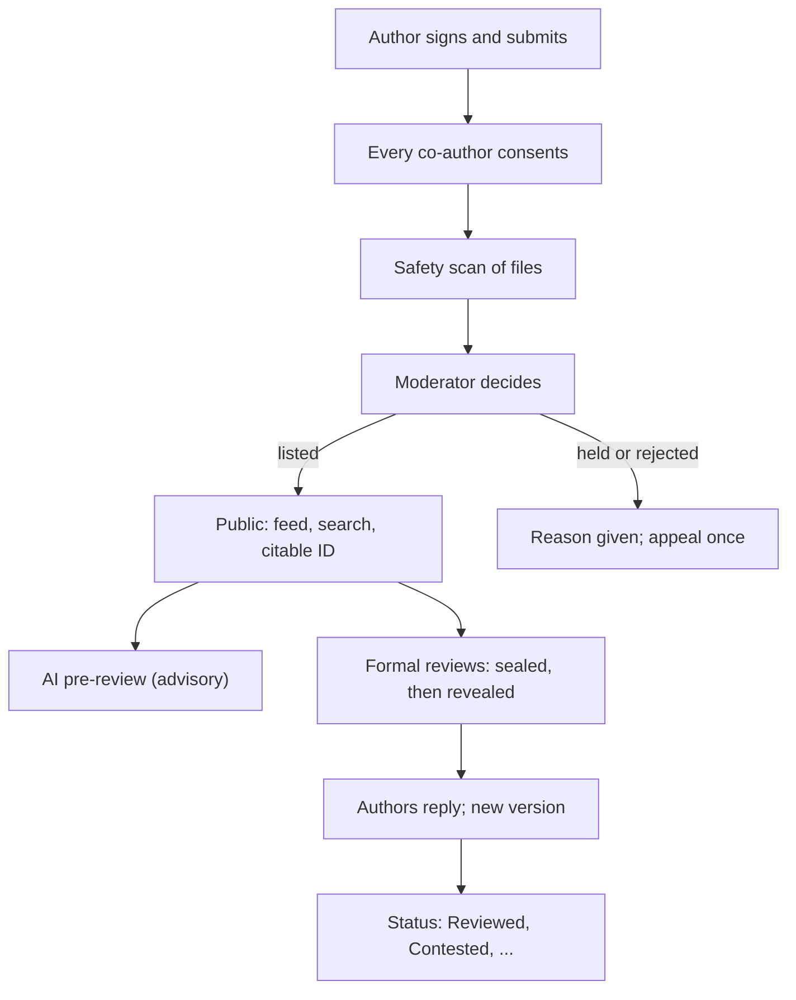

# 1. How Scholium works

Scholium is a preprint and peer-review network: **the arXiv you can verify, review in the open, and never lose.** Authors publish papers for free, reviewers review them in the open, and every reader can check for themselves that what they are reading is genuine.

The name comes from a *scholium*, a note written in the margin of a scholarly text. On Scholium a paper lives together with its reviews, annotations and corrections, in the margin beside it.

## Six ideas behind Scholium

### 1. Everything is a signed record

Every paper, version, review, consent and moderation decision is a **record** signed by the person who made it. You sign with a **passkey** on your own device. Your signing key never leaves the device, and the Scholium server never sees it. The server only ever receives public keys and signatures, so it cannot forge a record in your name.

### 2. Nothing is edited; papers have versions

A signed version can never be changed. To update a paper you publish a **new version**, linked to the one before it. Every version stays available at its own permanent ID, such as `sch:k3f9-q2xz-7mwd/v2`. Corrections and retractions are added as new records; they never overwrite the old ones.

### 3. Anyone can check the record

Your browser checks every paper's signatures, history and files when you open it, and shows the result as a badge. You can also download a paper, or the whole public archive, and check it offline with the `scholium` verifier. You do not have to trust the server. See [Chapter 4](04-checking-a-paper-is-genuine.md).

### 4. Review is structured, sealed, then revealed

Formal reviews score a paper on six dimensions with written justifications. A review is **sealed** when committed, and revealed only once a second reviewer has committed or 21 days have passed, so reviewers cannot be swayed by each other. Reviewers can stay anonymous while remaining accountable. A paper's status (Preprint, Under review, Reviewed and so on) follows from the reviews by a fixed rule. See [Chapter 6](06-reviewing-a-paper.md).

### 5. AI helps, but never decides

Every listed paper gets an AI pre-review from several specialist agents. Every finding must cite evidence, and the report is clearly labelled "Advisory. Generated by AI agents. Not a peer review." It can never change a paper's status. See [Chapter 8](08-ai-pre-review.md).

### 6. Every decision shows its reason

Moderators decide only whether a submission is listed, never whether the science is right. Every decision cites a published policy clause, gives a reason, is a public record, and can be appealed once to a panel of peers. See [Chapter 9](09-moderation-appeals-and-reports.md).

Two things Scholium deliberately does **not** have: like or vote counts on papers, and any token or cryptocurrency. Quality is shown by reviews, not popularity.

## Who does what

What you can do depends on your **trust tier**, which grows as you link your identity and as other members vouch for you. [Chapter 2](02-your-account.md#trust-tiers) explains how to move up.

| Role | Tier | Typical activities |
| --- | --- | --- |
| Reader | 0 | Read, search, verify, cite, report, sign co-author consents |
| Member | 1 | Discuss papers, annotate paragraphs |
| Author | 2 | Publish papers and new versions, respond to reviews |
| Reviewer | 3 | Write formal reviews, rate reviews, endorse new authors, sit on appeal panels |
| Moderator | 4 | Decide what is listed, handle reports, sit on appeal panels |

## The life of a paper

| Stage | Who | Chapter |
| --- | --- | --- |
| Submit | Author | [5](05-publishing-a-paper.md) |
| Consent | Every co-author | [5](05-publishing-a-paper.md#co-author-consent) |
| Safety scan and checks | Automatic | [5](05-publishing-a-paper.md#the-safety-scan) |
| Moderation | Moderator | [9](09-moderation-appeals-and-reports.md) |
| AI pre-review | Automatic | [8](08-ai-pre-review.md) |
| Formal review | Reviewers | [6](06-reviewing-a-paper.md) |
| Discussion and annotations | Members | [7](07-discussion-and-annotations.md) |
| New versions and notices | Authors | [5](05-publishing-a-paper.md#publish-a-new-version) |

## Where things are

| Page | Address | What it is for |
| --- | --- | --- |
| Home | `/` | What Scholium is, with links to the papers and this handbook |
| Papers | `/papers` | Latest, Reviewed and Following papers |
| Docs | `/docs` | This handbook, with screenshots and a short video per chapter |
| Category | `/c/{category}` | One category's papers, follow it, its Atom feed |
| Search | `/search` | Keyword and semantic search with filters |
| Paper | `/p/{id}` | Read a paper; its reviews, AI report, discussion, versions, files and proof |
| Submit | `/submit` | Publish a new paper |
| Review | `/review/{id}` | Write a formal review |
| Dashboard | `/me` | Things needing your attention, your papers, reviews, notifications |
| Security | `/me/security` | Device key, guardians, key rotation, profile erasure |
| Profile | `/u/{DID}` | Someone's public profile; endorse them |
| Moderation | `/mod` | Moderation queue (tier 4) |
| Verify a file | `/verify` | Check a file you already have |
| Network | `/network` | The server's transparency page and public archive |
| Policies | `/policies` | The moderation policy clauses |
| Sign in | `/signin` | Sign in or create an account |
| Recover | `/recover` | Recover an account after losing your device |

On a computer, the navigation bar holds the logo, search, **Categories**, **Submit**, notifications and your account. On a phone it becomes a bar at the bottom: **Home**, **Search**, **Submit**, **Inbox** and **Me**.

## What this release includes

This is the first release of Scholium (Phase 1, the community pilot). Some parts of the design are switched off or planned for later, and the website says so where they would appear.

| Available now | Planned for later releases |
| --- | --- |
| Signed records, versions, permanent IDs | Hourly public timestamps on a blockchain ("anchoring"). Until then every paper shows **anchor pending**. |
| In-browser verification, offline verifier, full public export | Copies of every paper kept by several independent operators. Today: "1 of 1 local copy". |
| Passkey accounts, ORCID linking, trust tiers, endorsements, recovery guardians | Institutional credentials, adding more devices to one account |
| Submission, co-author consent, safety scan, checks, moderation, appeals | DOIs for listed versions; submission from a Git tag |
| Discussion, annotations, formal review with sealed reveal | Anonymous-review credentials that even the server cannot link; threshold opening of reviewer identities |
| Advisory AI pre-review with a reproduction sandbox | Reviewer reputation, research credits, governance and elections, federation of many servers |

[Chapter 10](10-faq-and-known-limitations.md) lists the known limitations of this release in detail.
