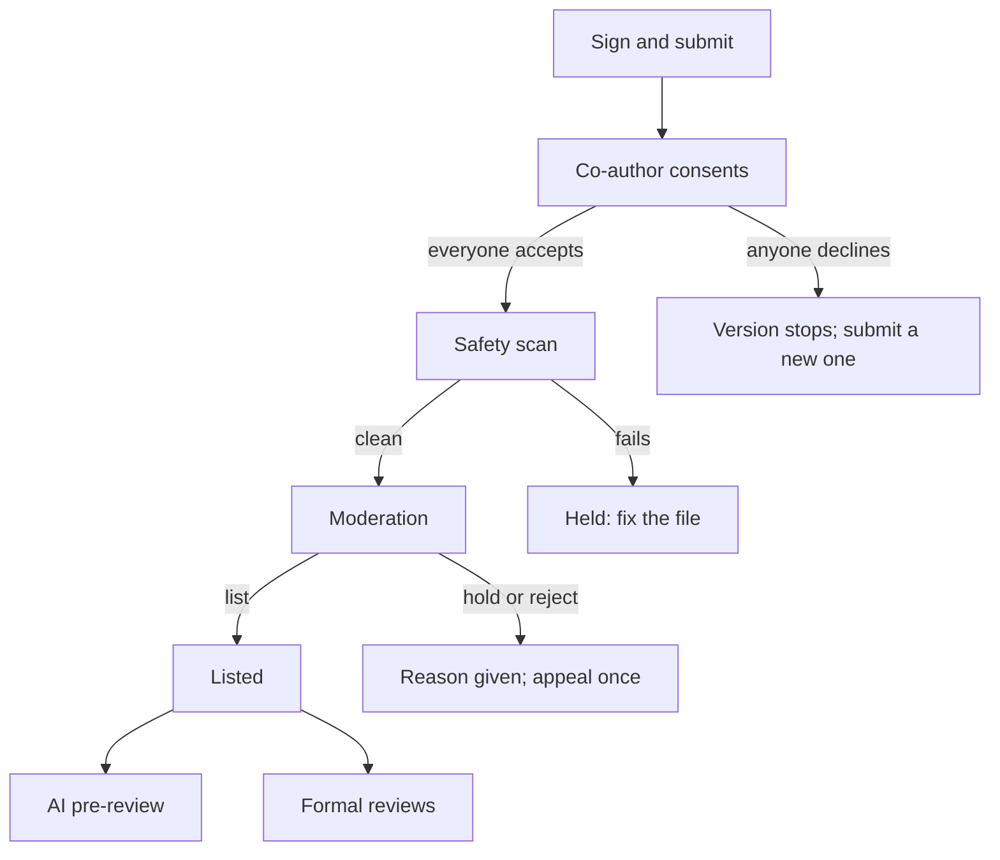

# 5. Publishing a paper

This chapter takes you from files on your computer to a listed, citable paper, and then through new versions and notices.

## Before you start

Check these first. Each one stops a submission if it is missing.

| You need | Why | Where |
| --- | --- | --- |
| **Tier 2 (Author)** | Only authors can start papers | [Trust tiers](02-your-account.md#trust-tiers) |
| **An endorsement in every category you will choose** | Required for each category on the paper | [Endorsements](02-your-account.md#endorsements) |
| **Each co-author's Scholium DID** | Co-authors are added by their DID; each needs a Scholium account | Ask them to copy it from their dashboard **Credentials** card |
| **Your files** | A PDF and/or LaTeX source; code and data as `.zip` or `.tar.gz` | — |
| **The same browser throughout** | Your draft is saved in this browser only | — |

The submit page lists anything that blocks you before you begin, for example "Submitting needs an Author account" or "New Author accounts can start one new paper a week".

## From submission to listing

## The submit wizard

Go to **Submit** in the navigation bar (**/submit**). The wizard has five steps: **Files → Details → Authors → Checks → Sign**. Your progress saves automatically in this browser ("Draft saved").

### Step 1: Files

There are two drop zones:

- **Paper**: your PDF, LaTeX source, figures (`.png`, `.jpg`, `.svg`, `.eps`) or an archive of them.
- **Code and data (optional)**: code and datasets, as `.zip`, `.tar`, `.tar.gz` or `.tgz`. Compress folders first.

Each file gets a role: Paper PDF, LaTeX source, Code or Data.

| Limit | Value |
| --- | --- |
| PDF | 50 MiB |
| Any other file | 5 GiB |
| Upload allowance per day | 2 GiB for accounts under 90 days old, 20 GiB after |

**Uploads resume.** If your connection drops, the upload retries. If you close the page, add the same file again and it continues where it stopped. Each file has **Pause**, **Resume**, **Retry** and **Remove**. Unfinished uploads are deleted after 24 hours.

You need a finished PDF or LaTeX source to continue.

### Step 2: Details

| Field | Rules |
| --- | --- |
| Title | Up to 300 characters |
| Abstract | Up to 5,000 characters. Type or paste it; it is not read from your file. |
| Categories | One to three, from the list below |
| Licence | Default **CC BY 4.0** |

**Licences.** Each option explains itself in one line and says whether journals usually accept it:

| Licence | What it allows | Journals |
| --- | --- | --- |
| CC BY 4.0 (default) | Reuse with credit, including commercially | Accepted by most journals and funders |
| CC BY-SA 4.0 | Reuse with credit; new works must carry the same licence | Some journals cannot accept it |
| CC BY-NC 4.0 | Reuse with credit for non-commercial use only | Many open-access mandates exclude it |
| CC BY-NC-ND 4.0 | Reuse unchanged, with credit, non-commercially | Few journals or funders accept it |
| CC0 1.0 | Public domain; anyone may reuse it without credit | Accepted |

The licence is stored inside the signed record and cannot be changed for that version.

**Categories:**

| Group | Categories |
| --- | --- |
| Computer science | `cs.AI` Artificial intelligence · `cs.CL` Computation and language · `cs.CR` Cryptography and security · `cs.CV` Computer vision · `cs.HC` Human–computer interaction · `cs.IR` Information retrieval · `cs.LG` Machine learning · `cs.MA` Multiagent systems · `cs.SE` Software engineering |
| Statistics | `stat.ML` Machine learning · `stat.ME` Methodology · `stat.TH` Statistics theory |
| Mathematics | `math.OC` Optimization and control · `math.ST` Statistics theory · `math.CO` Combinatorics |
| Physics | `physics.comp-ph` Computational physics · `physics.soc-ph` Physics and society |
| Quantitative biology | `q-bio.NC` Neurons and cognition · `q-bio.QM` Quantitative methods |
| Electrical engineering and systems science | `eess.AS` Audio and speech processing · `eess.SP` Signal processing |
| Economics | `econ.EM` Econometrics · `econ.GN` General economics |

### Step 3: Authors

You are on the author list already. For each co-author:

1. Enter their **DID** in "DID, ORCID iD or email", and optionally their name.
2. Choose **Add co-author**.
3. Give them at least one **CRediT role** (for example Conceptualization, Software, Writing – original draft). You need at least one role too.
4. Use **Move up** and **Move down** to set the order of names.

> **Use DIDs.** In this release Scholium cannot look up an account by ORCID iD or email. An author added that way shows "Not matched" and blocks the step until you remove them or add them by DID.

### Step 4: Checks

This step lists the automated checks: **File safety**, **References**, **Similarity** and **Metadata match**. They run after you sign and every co-author consents, so here they show "Not run yet". You can continue. Their results appear on your status tracker and are explained [below](#automated-checks).

### Step 5: Sign

Review the summary. The page reminds you: "You are signing version 1 of this paper. This cannot be edited later; you can publish a new version at any time."

Choose **Sign and submit**. Your device signs the paper, its file list and its first version, so **expect three passkey prompts**. Scholium never sees your key.

You will see **Submitted – version 1**.

## After you submit: the status tracker

The tracker on your paper shows each stage as **Done**, **In progress**, **Needs attention** or **Not started**:

1. **Submitted**
2. **Co-author consents** (for example 2/3)
3. **Scan**
4. **Moderation** ("Target: 48 hours")
5. **Listed**
6. **AI pre-review** ("Advisory, after listing")

**You must consent too.** Every person on the author list, including you, signs a consent. A **Sign your consent** button appears on the tracker until you do.

## Co-author consent

Nobody can be published as an author without agreeing. Each author receives a notification (and an email, if they have a confirmed address) linking to **/consent/{version}**. On that page ("Review and sign"):

- Optionally add a public comment of up to 500 characters.
- Choose **Accept authorship** or **Decline authorship**. Declining asks you to confirm.
- "You're signing with your passkey. Scholium never sees your key."

The paper's files cannot be opened during consent; they open once the safety scan has passed.

| Outcome | What happens |
| --- | --- |
| Everyone accepts | The version moves on to the safety scan. |
| Anyone declines | The version stops and goes back to draft, naming who declined. It cannot ask for consent again. Fix the author list and submit a new version. |

Answers are final.

## The safety scan

Before anyone can open your files, Scholium inspects them:

- **PDFs** are checked for embedded JavaScript, embedded files, actions that launch programs, hidden text (tiny, white or invisible) and text that tries to instruct AI tools. Encrypted or unreadable PDFs fail.
- **Archives** are checked for unsafe paths and links, and scanned for malware.

Files are inspected, never altered. If a file fails, the version is **held** and the tracker shows, for example, "paper.pdf failed the safety scan: JavaScript…" with **Needs fixing** and **Replace in Files**. Fix the file and submit a new version.

## Automated checks

When your version reaches moderation, Scholium runs three checks. You and the moderators see the results before listing; everyone sees them after.

| Check | What it reports |
| --- | --- |
| Similarity | The highest overlap of five-word phrases with any listed paper: **Low overlap** under 15%, **Worth a look** from 15%, **High** from 30% |
| References | How many references could be resolved |
| Metadata match | Whether your signed title appears on the first page of the PDF |

A failed file and a title mismatch are shown as problems to fix. High similarity and unresolved references do not block listing, but moderators see them.

## Moderation

A volunteer moderator reviews every new version. The target is a decision within **48 hours**. The moderator chooses one of:

| Decision | Result |
| --- | --- |
| List | The version is public in the feed, search and category pages. |
| Hold | Kept out of listing until a problem is fixed. |
| Reclassify | Moved to a different category. Content is untouched. |
| Reject | Not listed. |

Every decision names a **policy clause** and gives a **reason**, and is a public signed record. The policies are on **/policies** and summarised in [Chapter 9](09-moderation-appeals-and-reports.md#the-policy-clauses).

**If your paper is held or rejected**, the first author is notified, and the paper page shows "Held from listing" or "Not listed" with the reason and "You can appeal once." See [Appeals](09-moderation-appeals-and-reports.md#appeals).

## Once your paper is listed

- **Your paper has a permanent ID**, for example `sch:k3f9-q2xz-7mwd`, and each version has its own: `sch:k3f9-q2xz-7mwd/v1`. The ID ends in a checksum, so typos are caught. Share the paper's page `/p/k3f9-q2xz-7mwd`, or the ID itself: searching for it opens the paper.
- It appears in the feed, its category page, search, Atom feeds and readers' daily digests.
- The **AI pre-review** starts ([Chapter 8](08-ai-pre-review.md)).
- Reviewers can review it ([Chapter 6](06-reviewing-a-paper.md)). Use **Invite reviewer** to point a reviewer at it.

## Publish a new version

Papers are never edited. To change one, publish a new version:

1. On your paper page choose **New version** (**/submit/new-version/{id}**).
2. The form starts from the latest version. Keep or replace files.
3. Write a **Change note (required)**, up to 500 characters, saying what changed.
4. Choose **Sign and submit version {n}**.

The new version goes through consent, the safety scan and moderation again. The author list carries over. Earlier versions stay available, and show "A newer version exists".

The latest version's authors, or a moderator, can publish a new version.

## Corrections, retractions and withdrawals

Use **Issue notice** on the paper page. A reason is required. Any author of the paper, or a moderator, can issue a notice. It applies to every version.

| Notice | Use it when | Effect |
| --- | --- | --- |
| Correction | An error needs pointing out but the work stands | Status becomes **Corrected**; a banner shows on every version |
| Retraction | The work should no longer be relied on | Status becomes **Retracted**; banner on every version and in citations |
| Withdrawal | You no longer stand behind the paper | Recorded as a notice; status does not change |

Retraction and withdrawal ask you to confirm. Notices cannot be undone: the paper and its history remain, with the notice added.

## Papers imported from arXiv

Moderators can mirror a paper's details from arXiv. In this release imports are made through the API only, and claiming an imported paper as its author is not yet available in the web app.
