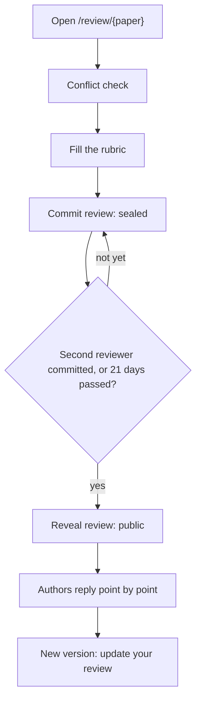

# 6. Reviewing a paper

Formal reviews are the heart of Scholium. They are structured, signed, published next to the paper, and decide its status. This chapter is for reviewers, and for authors who want to know how their paper will be reviewed.

Formal reviews are different from **discussion** ([Chapter 7](07-discussion-and-annotations.md)), which is open to any member, and from the **AI pre-review** ([Chapter 8](08-ai-pre-review.md)), which is advisory only.

## Who can review

- You need **tier 3 (Reviewer)**. The node operator grants it.
- You **cannot review a paper you are an author of**.
- You can write **one review per paper**, across all its versions. When the authors publish a new version, you update your review instead of writing a second one.
- You do not need an invitation.

### Invitations

An author of a paper, or a moderator, can invite a reviewer with **Invite reviewer** on the paper page. The person invited must be a tier-3 reviewer, endorsed in the paper's category if they hold any endorsements. They see "Review invitation" in **Needs your attention** on their dashboard. In this release an invitation is a pointer only: there is nothing to accept or decline, and you can review without one.

## The review flow at a glance

## 1. Open the review form

On the paper's **Reviews** tab choose **Review this paper**, or go to **/review/{paper id}**. The form shows the paper beside it.

## 2. The conflict check

The form runs three checks and marks each as pass, fail or unknown:

- "Not an author of this paper"
- "No co-authorship with any author in the last 3 years"
- "Different institution from all authors". If you have not saved an affiliation, the form asks you to: "Save an affiliation on your profile so the node can compare it with the authors'."

Only the first check blocks you. The other two are **advisory**. As the form puts it: "Only authors of the paper are refused; the other checks are advisory. If one fails, decide whether you can review fairly." Decline if you cannot.

## 3. Choose anonymous or signed

By default **you review anonymously**. Your review is published as "Reviewer A", "Reviewer B" and so on. The letter is stable for the paper across versions.

Your identity is not stored in readable form. When you commit, Scholium stores your identity encrypted with the integrity committee's key, so it can only be opened in a misconduct case.

> **In this release** the escrow uses a single committee key; a scheme that needs several committee members to agree is planned. There is no way to open an identity through the website or the API.

If you prefer public credit, choose **Sign with my name instead**. Your review then appears under **Signed reviews** on your public profile once revealed. On the paper's Reviews tab it keeps its letter and reads "Signed by {your name}", linking to your profile (a short form of your DID if you have erased your profile). When you come back to a review you signed, the form opens in the signed state on any device, with **Stay anonymous instead** offered.

## 4. Fill the rubric

Score each of six dimensions from 1 to 5, and write a **justification for every score**. A review without them is rejected.

| Dimension | What to judge |
| --- | --- |
| Soundness of method | Is the method appropriate and correctly applied? |
| Evidence for claims | Do the results support the claims? |
| Reproducibility | Could someone else reproduce the work from what is provided? |
| Novelty | What does this add to existing work? |
| Clarity | Is it clearly written and presented? |
| Limitations & ethics | Are limitations and ethical issues stated honestly? |

Then set:

- **Confidence**: Low, Medium or High.
- **Recommendation**: one of the four below. This is what drives the paper's status.

| Recommendation | Effect on status |
| --- | --- |
| Sound as is | Counts toward **Reviewed** |
| Minor revisions | Counts toward **Reviewed** |
| Major concerns | Keeps the paper **Under review** |
| Fundamentally flawed | Makes the paper **Contested** |

You can add an optional **Written report** in Markdown, and tick **I used AI assistance in writing this review** if you did. Once revealed, your review shows "AI assistance declared" on the paper's Reviews tab.

## 5. Commit the review (sealed)

Choose **Commit review**. "Committing signs the review with a per-paper key and seals it until it is revealed." Nobody, including the authors, other reviewers and the server, can read it yet. You see **Your review is sealed**.

Sealing stops reviewers from being influenced by each other. A review can be revealed when **either**:

- a **second reviewer** has committed a review of the same version, **or**
- **21 days** have passed since the first review of that version was committed.

The form tells you where things stand, for example "1 review has been committed on this version so far. Your review can be revealed once one more independent review is committed, or on 12 Dec 2026."

> **Save your review key.** The secret needed to reveal your review stays in the browser where you committed it. Export it as a **Review key file** protected by a passphrase of at least 8 characters, and keep it safe. Without it, you cannot reveal your review from another browser.

## 6. Reveal the review

Revealing is a step you take yourself: Scholium does not reveal reviews automatically. When the gate opens, return to the form and choose **Reveal review**. Your rubric, recommendation and report become public on the paper's **Reviews** tab.

Until then, the Reviews tab shows your review as sealed: "Report sealed until two reviews are committed on this version, or 21 days after the first."

## 7. Author replies

Authors can answer a review **point by point**: one reply per rubric dimension, plus a general reply. Replies appear under the review as "Author reply". Only people on the paper's author list can reply.

## 8. Update your review for a new version

When the authors publish a new version, choose **Update for v{n}** on the form. An update:

- needs a complete rubric again;
- can replace your earlier review once;
- publishes your **scores and recommendation immediately**. Your written report follows when the new version's reveal gate opens.

## Rate other reviews

Any reviewer who did not write a review and is not an author of the paper can rate it once, from 1 to 5, with **Rate this review's quality**. "1 is a review that does not help, 5 is one that sharpens the paper. You rate the review, not the paper. Ratings are recorded with the review and never change the paper's status." Reviewer reputation is planned for a later release.

## How paper status is decided

Status is computed from signed records only, by a fixed rule, so any server computes the same answer. Scholium works down this list and uses the **first** rule that matches:

| # | If… | Status |
| --- | --- | --- |
| 1 | A retraction notice exists | **Retracted** |
| 2 | A moderator's hold is in force on any version | **Contested** |
| 3 | Any reviewer's current review says **Fundamentally flawed** | **Contested** |
| 4 | A correction notice exists | **Corrected** |
| 5 | At least **two** reviewers have revealed reviews, and **every** current review says Sound as is or Minor revisions | **Reviewed** |
| 6 | At least one review has been committed | **Under review** |
| 7 | Otherwise | **Preprint** |

A reviewer's "current" review is their latest update. Discussion, helpful votes, review ratings, AI findings and withdrawal notices **never** change status.

### What authors can do

- Reply to each review point by point.
- Publish a new version that addresses the reviews ([Chapter 5](05-publishing-a-paper.md#publish-a-new-version)). Reviewers can then update their recommendation.
- Issue a correction or retraction notice if needed.
