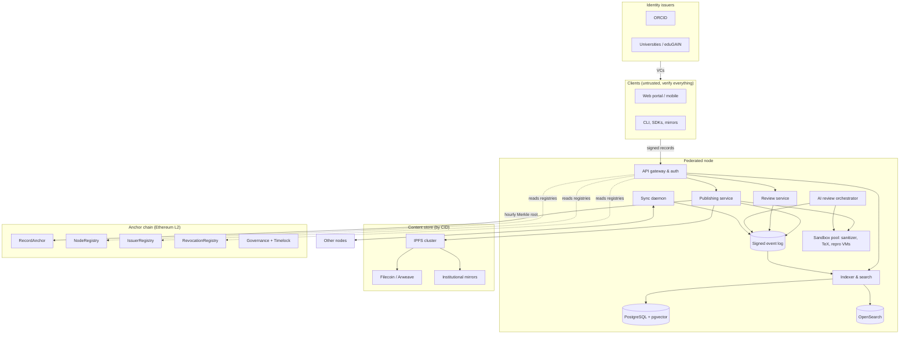
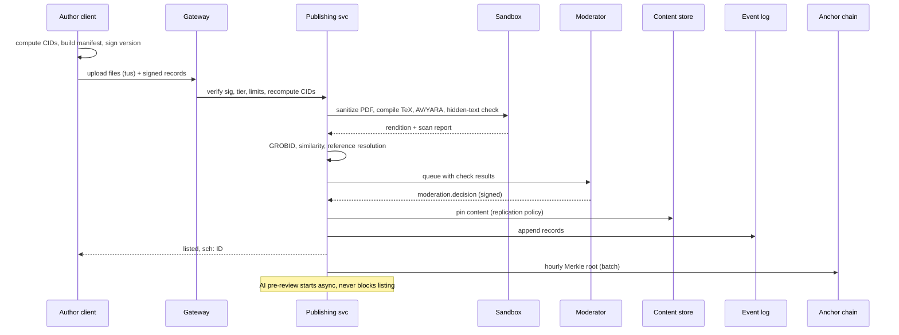
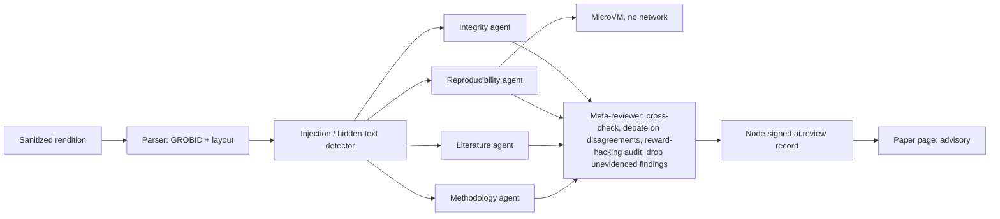

# Scholium — Technical Architecture

| | |
| --- | --- |
| Product | **Scholium** (formerly working title "OpenResearch") |
| Document | Technical architecture v1.0 |
| Date | 2026-11-14 |
| Companion docs | `PRD.md` (requirements), `design.md` (UX/UI design) |

## 1. Architecture in one paragraph

Scholium is a hybrid-decentralized network. The **record** (papers, versions, reviews, credentials, decisions) is a set of signed, content-addressed objects. **Federated nodes** validate, store, index and gossip records. A **public L2 chain** holds only Merkle roots, registries and votes. **Content** lives in CID-addressed storage replicated across independent operators. The portal, search and AI agents are replaceable services. Nothing a node says has to be trusted: clients verify.

Design rules:

1. Decentralize the record, not the UI.
2. Hashes and proofs on-chain; never content or personal data.
3. Every write is signed by a key the author controls.
4. Fail open for reads, fail safe for writes.
5. Indexes are caches; the event log is the source of truth.

## 2. System context



## 3. Record model

### 3.1 Envelope

```json
{
  "v": 1,
  "type": "paper.version",
  "id": "bafyrei...",
  "author": "did:key:z6Mk...",
  "created": "2026-11-14T05:33:00Z",
  "prev": "bafyrei... | null",
  "body": {},
  "proofs": ["<VC or ZK presentation>"],
  "sig": "<Ed25519 over canonical(v,type,author,created,prev,body,proofs)>"
}
```

- Encoding: DAG-CBOR (IPLD) for hashing; JSON view canonicalized with JCS (RFC 8785).
- ID: CIDv1, sha2-256, codec dag-cbor, computed over the envelope without `id` and `sig`.
- Signature: Ed25519. `v` allows adding a second (post-quantum, ML-DSA) signature later.
- `created` is informational. Trusted time is the anchor block.

### 3.2 Record types

| Type | Body (main fields) | Signed by |
| --- | --- | --- |
| `paper.genesis` | seed, initial authors, categories, licence | Submitting author |
| `paper.version` | paper, n, title, abstract, authors[{did, credit roles}], manifest, licence, changeNote | Submitting author |
| `manifest` | files[{path, cid, size, mediaType, role}] | Submitting author |
| `coauthor.consent` | version, role | Each co-author |
| `review.commit` | target version, commitment hash, nullifier | Review key |
| `review.formal` | target, scores{}, reportCid, confidence, recommendation, coi, escrow | Review key + credential proof |
| `review.response` | review, replyCid, items[] | A paper author |
| `review.rating` | review, rating, noteCid | Tier-3 member |
| `discussion.post` | target, anchor, textCid, parent | Member |
| `ai.review` | target, agents[], models[], promptSetHash, findingsCid, evidence[] | Node key |
| `rendition` | source version, sanitized files, tool versions | Node key |
| `endorsement` | endorsee, category, expiry | Tier-3 endorser |
| `moderation.decision` | target, action, clause, reasonCid | Moderator key |
| `appeal` / `appeal.decision` | target decision, grounds / outcome, reasons | Appellant / panel threshold key |
| `retraction` / `correction` | target, reason, replacement | Authors or integrity committee |
| `curation` | target, collection, statement | Overlay journal / collection key |
| `key.rotation` | oldKey, newKey, recoveryProof | Old key or guardians |
| `erasure.request` | content CIDs, basis | Data subject or node |
| `external.mirror` | source (arXiv/Zenodo id), metadata, manifest | Node key (unclaimed until an author signs) |

### 3.3 Identifiers

- Paper: `sch:` + 12 base32 chars of the genesis CID + checksum, grouped `xxxx-xxxx-xxxx`.
- Version: `sch:xxxx-xxxx-xxxx/vN` → exact version CID.
- DOI (optional): via DataCite; landing URL resolvable on any node.

### 3.4 Verification algorithm (client)

```text
verify(paperId):
  genesis  = fetch(paperId)                       ; check sig
  versions = follow prev links newest → genesis   ; check each sig, each prev hash
  for v in versions:
      manifest = fetch(v.manifest)                ; check file CIDs lazily on download
      require consent record from every listed author
      proof = fetch(/records/{v.id}/proof)
      require merkleVerify(proof.path, v.id, proof.root)
      require chain.RecordAnchor.root(proof.node, proof.seq) == proof.root   ; or "pending"
  apply supersession: retraction / correction / tombstone
  return {status, anchoredAt, signers}
```

## 4. Identity and credentials

| Concern | Design |
| --- | --- |
| Identifier | `did:key` (Ed25519) at signup; upgrade path to rotatable `did:web` / PLC-style DID |
| Custody | WebAuthn passkey unlocks a device-held signing key (non-extractable WebCrypto key or secure enclave); hardware token optional; institutional custody optional |
| Login | `POST /auth/challenge` → sign nonce → `POST /auth/verify` → 15-min access token, DPoP-bound, refresh token rotation |
| Credentials | W3C Verifiable Credentials 2.0: ORCID ownership, affiliation, reviewer-in-category, contribution facts |
| Uniqueness | Nullifier = H(issuerId ‖ subjectId ‖ domain) stored in `RevocationRegistry`; one person → one active DID without publishing the link |
| Recovery | 3-of-5 guardians sign `key.rotation`; 72-hour contest window |
| Revocation | W3C Bitstring Status List; root anchored on-chain; verifiers download the list |

Trust tiers: 0 Reader · 1 Member (DID + email + ORCID or institution) · 2 Author (endorsed) · 3 Reviewer (publication record or appointment) · 4 Moderator / committee (governance-appointed).

### Anonymous, accountable review

Phase 1 (escrow): the node stores `Enc_committeeKey(reviewerDID)` with each review; the plaintext mapping is never written. Committee key is a 3-of-5 threshold key.

Phase 2 (zero-knowledge):

```text
public inputs : paperId, categoryRoot (Merkle root of reviewer credentials),
                revocationRoot, authorSetCommitment, nullifier, reviewPubKey
private inputs: credential, secret, Merkle path
statement     : credential ∈ categoryRoot ∧ not revoked
                ∧ holder ∉ authorSet ∧ no COI per committed rules
                ∧ nullifier = H(secret ‖ paperId)
                ∧ reviewPubKey = derive(secret, paperId)
escrow        : ThresholdEnc(holderDID) attached; opened only by 3 of 5 committee
```

Candidate schemes: BBS+ selective disclosure, or Semaphore-style group membership (Groth16/PLONK). Use an audited library; no custom circuits beyond the COI check.

## 5. Publishing pipeline



Limits (defaults): PDF 50 MB; bundle 5 GB (larger via repository pointer + hash); tier-2 new accounts 1 submission/week.

Failure handling: co-author refusal → cannot list with that author; scan failure → hold with exact failing check; chain down → `anchor: pending`, anchored later; duplicate genesis on another node → merge by CID.

## 6. Storage

| Tier | Technology | Replicas / policy |
| --- | --- | --- |
| Hot | IPFS Cluster + S3-compatible store behind a CID gateway | Node-local |
| Warm | Pins on ≥ 2 other federation nodes, different jurisdictions | Papers: ≥ 5 replicas, ≥ 3 operators, ≥ 2 jurisdictions |
| Cold | Filecoin deals (auto-renew); Arweave for records and opt-in content | ≥ 1 cold copy |
| Archive | Nightly signed CAR snapshot + log to libraries | Per agreement |

- Availability prober: every 24 h, random byte-range challenges against each claimed replica, verified against the Merkle DAG; 3 failures → replica dropped and re-replication.
- Encryption: private drafts, identity escrows and erasable fields use per-object keys in KMS/HSM; erasure = key deletion (crypto-shredding).
- Takedown: `moderation.decision{action: tombstone}` → unpin + shared denylist; envelope and anchor remain.
- Quarantine: content is held out of permanent storage for 90 days.
- Node recovery objectives: RPO 5 min, RTO 4 h.

## 7. Node internals

### 7.1 Services

| Service | Language | Responsibilities |
| --- | --- | --- |
| `gateway` | Python (FastAPI) | TLS, auth, rate limits, request validation |
| `record-core` | Rust | Canonicalization, CID, signature and proof verification, Merkle batching (also compiled to WASM for clients) |
| `publishing` | Python | Ingest workflow, moderation queue, DOI requests |
| `review` | Python | Reviews, commit–reveal, discussion, appeals |
| `ai-orchestrator` | Python (LangGraph) | Agent graph, evidence checks, signing reports |
| `sandbox-runner` | Go/Rust | Firecracker/gVisor jobs: sanitizer, TeX, reproduction |
| `indexer` | Python | Log → Postgres/OpenSearch/pgvector, citation graph |
| `syncd` | Rust | Gossip, set reconciliation, snapshots, probes |
| `anchord` | Rust | Batch roots, submit to chain, store proofs |
| Workflow engine | Temporal | Retries, idempotency for long pipelines |

### 7.2 Core relational schema (materialized from the log)

```sql
-- Source of truth: append-only, hash-chained
CREATE TABLE event_log (
  seq         BIGSERIAL PRIMARY KEY,
  record_cid  TEXT NOT NULL UNIQUE,
  record_type TEXT NOT NULL,
  author_did  TEXT NOT NULL,
  body        JSONB NOT NULL,
  raw         BYTEA NOT NULL,              -- canonical DAG-CBOR bytes
  prev_hash   BYTEA NOT NULL,              -- hash of previous log entry
  entry_hash  BYTEA NOT NULL,
  received_at TIMESTAMPTZ NOT NULL DEFAULT now(),
  batch_seq   BIGINT,                      -- anchor batch, null = pending
  origin_node TEXT NOT NULL
);
REVOKE UPDATE, DELETE ON event_log FROM PUBLIC;

CREATE TABLE anchor_batch (
  batch_seq   BIGINT PRIMARY KEY,
  merkle_root BYTEA NOT NULL,
  log_head    BYTEA NOT NULL,
  record_count INT NOT NULL,
  chain_id    BIGINT, tx_hash BYTEA, block_time TIMESTAMPTZ,
  status      TEXT NOT NULL CHECK (status IN ('pending','submitted','final'))
);

-- Derived views (rebuildable)
CREATE TABLE paper (
  paper_cid  TEXT PRIMARY KEY,
  short_id   TEXT NOT NULL UNIQUE,         -- sch:xxxx-xxxx-xxxx
  categories TEXT[] NOT NULL,
  licence    TEXT NOT NULL,
  status     TEXT NOT NULL,                -- preprint|under_review|reviewed|contested|corrected|retracted
  latest_version_cid TEXT,
  listed_at  TIMESTAMPTZ
);

CREATE TABLE paper_version (
  version_cid TEXT PRIMARY KEY,
  paper_cid   TEXT NOT NULL REFERENCES paper,
  n           INT  NOT NULL,
  title       TEXT NOT NULL,
  abstract    TEXT NOT NULL,
  manifest_cid TEXT NOT NULL,
  prev_cid    TEXT,
  anchored_at TIMESTAMPTZ,
  embedding   vector(1024),
  fts         tsvector,
  UNIQUE (paper_cid, n)
);

CREATE TABLE authorship (
  version_cid TEXT REFERENCES paper_version,
  author_did  TEXT NOT NULL,
  position    INT  NOT NULL,
  credit_roles TEXT[],
  consent_cid TEXT,                        -- null until consent signed
  PRIMARY KEY (version_cid, author_did)
);

CREATE TABLE review (
  review_cid  TEXT PRIMARY KEY,
  version_cid TEXT NOT NULL REFERENCES paper_version,
  review_key  TEXT NOT NULL,               -- per-paper pseudonymous key
  nullifier   BYTEA NOT NULL,
  scores      JSONB, recommendation TEXT, confidence INT,
  report_cid  TEXT,
  committed_at TIMESTAMPTZ, revealed_at TIMESTAMPTZ,
  UNIQUE (version_cid, nullifier)
);

CREATE TABLE moderation_decision (
  decision_cid TEXT PRIMARY KEY,
  target_cid   TEXT NOT NULL,
  action       TEXT NOT NULL,              -- list|hold|reclassify|reject|delist|tombstone
  clause       TEXT NOT NULL,
  moderator_did TEXT NOT NULL,
  decided_at   TIMESTAMPTZ NOT NULL
);

-- Erasable personal data, never in records
CREATE TABLE profile (
  did TEXT PRIMARY KEY,
  enc_blob BYTEA NOT NULL,                 -- name, affiliation, email (per-object key)
  key_ref  TEXT NOT NULL,
  tier     INT  NOT NULL DEFAULT 1
);

CREATE TABLE replica (
  cid TEXT, provider TEXT, kind TEXT,      -- hot|warm|cold|archive
  last_probe TIMESTAMPTZ, probe_failures INT DEFAULT 0,
  PRIMARY KEY (cid, provider)
);
```

## 8. AI review subsystem



Rules:

- Paper text is passed as quoted data in a separate channel, never concatenated into instructions. Agents have no tool that writes records or status.
- At least two model families across the agent set. Private drafts → self-hosted models only (Ollama / MLX / vLLM).
- Every finding carries `{span|referenceId|logLine}` evidence; the meta-reviewer deletes any finding without it.
- Reproduction: Firecracker/gVisor microVM, no network, hash-pinned dependency mirror, read-only root, CPU/GPU/time/disk quotas, no secrets, destroyed after each run.
- The record stores model IDs/versions and the hash of the public prompt set for replication.
- Release gates: seeded-error detection rate, false-accusation rate < 2%, expert agreement, 100% evidence traceability, injection robustness, cost per paper.
- Evaluation design: human-only vs single-LLM vs multi-agent vs multi-agent + reward-hacking audit on an expert-annotated set.

## 9. Federation protocol

| Role | Function |
| --- | --- |
| Full node | Accept, moderate, index, pin, anchor, AI review |
| Archive node | Replicate and pin everything; reads and exports |
| Index node | Consume logs; search/analytics; no pinning |
| Light client | Verify records and proofs against the chain |

- **Transparency log.** Each node signs its log head `(seq, entryHash)`. Two different signed heads for the same `seq` are an equivocation proof accepted by `NodeRegistry`, which suspends the node.
- **Discovery.** On-chain `NodeRegistry` (DID, key, endpoint hash, standing). Transport: libp2p or HTTPS with mTLS.
- **Live gossip.** Record CIDs announced on per-category pubsub topics; receivers fetch, verify, apply local moderation policy.
- **Anti-entropy.** Every 10 min, range-based set reconciliation over a Merkle search tree of record CIDs per category.
- **Bootstrap.** Signed CAR snapshot + log head from any peer or cold storage; full verification, then live sync.

| Conflict | Resolution |
| --- | --- |
| Duplicate record | Same CID, deduplicated |
| Two versions with the same `prev` | Both valid; first-anchored is canonical, other shown as branch |
| Moderation disagreement | Per-node; clients show "listed by N of M nodes" |
| Tombstone | Network-wide if signed by integrity committee or security council; otherwise advisory |
| Backdating | Self-declared time ignored; anchor order decides |

Interoperability: OAI-PMH, ActivityPub objects, Signposting/FAIR metadata, schema.org `ScholarlyArticle`.

## 10. Smart contracts

Chain: one mainstream Ethereum L2 (EVM) for hourly anchors, plus a weekly checkpoint of all node roots on Ethereum mainnet. Anchors are stored in records as `(chainId, contract, txHash, proof)` so chains can be added without record migration.

```solidity
// SPDX-License-Identifier: Apache-2.0
pragma solidity ^0.8.24;

interface INodeRegistry {
    function isActive(bytes32 nodeId) external view returns (bool);
    function signerOf(bytes32 nodeId) external view returns (address);
}

/// Non-upgradeable. A root can be written once and never changed.
contract RecordAnchor {
    struct Batch { bytes32 merkleRoot; bytes32 logHead; uint32 count; uint64 time; }

    INodeRegistry public immutable registry;
    uint256 public immutable minInterval;                    // e.g. 55 minutes
    mapping(bytes32 => mapping(uint64 => Batch)) public batches;   // nodeId => seq => batch
    mapping(bytes32 => uint64) public lastSeq;
    mapping(bytes32 => uint64) public lastTime;

    event Anchored(bytes32 indexed nodeId, uint64 indexed seq, bytes32 merkleRoot, bytes32 logHead, uint32 count);

    constructor(INodeRegistry r, uint256 interval) { registry = r; minInterval = interval; }

    function anchor(bytes32 nodeId, bytes32 merkleRoot, bytes32 logHead, uint32 count) external {
        require(registry.isActive(nodeId), "node inactive");
        require(msg.sender == registry.signerOf(nodeId), "not node signer");
        require(block.timestamp >= lastTime[nodeId] + minInterval, "too soon");
        uint64 seq = ++lastSeq[nodeId];
        batches[nodeId][seq] = Batch(merkleRoot, logHead, count, uint64(block.timestamp));
        lastTime[nodeId] = uint64(block.timestamp);
        emit Anchored(nodeId, seq, merkleRoot, logHead, count);
    }
}
```

| Contract | State | Writers | Upgradeable |
| --- | --- | --- | --- |
| `RecordAnchor` | Batch roots per node | Registered node signers | No |
| `NodeRegistry` | Node DID, signer, endpoint hash, status; accepts equivocation proofs | Timelock; node (own endpoint/key) | Proxy, admin = timelock |
| `IssuerRegistry` | Issuer DID, schema IDs, scope, status | Timelock; security council may suspend | Proxy |
| `RevocationRegistry` | Status-list roots per issuer; nullifier set | Issuers (own lists) | No |
| `Governance` + `Timelock` + `Treasury` | Proposals, vote attestations, queued actions, funds | Assembly; security council pause only | OpenZeppelin Governor/Timelock, Safe |

Contract engineering: Foundry unit, fuzz and invariant tests (root never overwritten; suspended node cannot anchor; timelock always enforced); Slither; two independent audits; bug bounty; no EOA admins after Phase 2. Users never need gas or a wallet.

## 11. Security architecture

Goal: no single compromised party (device, node, storage provider, issuer, chain) can forge, alter, backdate or erase the record, or unmask an honest reviewer.

| # | Threat | Mitigation | Residual |
| --- | --- | --- | --- |
| 1 | Forged/altered paper | Author signature, CID addressing, client verification | Stolen author key |
| 2 | Backdating | Anchor time; cross-signed log heads; mainnet checkpoints | ≤ 1 batch interval |
| 3 | Account takeover | Passkeys, DPoP tokens, rotation, social recovery, 72 h contest | Malicious records until detection; disavowal record |
| 4 | Sybil / review rings | Independent issuers, nullifiers, endorsement liability, graph signals, rate limits | Collusion of real researchers |
| 5 | Reviewer unmasking | ZK presentation, per-paper keys, threshold escrow, relay submission | Stylometry, tiny fields |
| 6 | Censorship by a node | Multi-node submission, public moderation reasons, portability | All nodes colluding → fork right |
| 7 | Content loss | Replication policy, probes, cold storage, archives, rebuild drills | Correlated failure |
| 8 | Malicious uploads | Sandboxed sanitization, CDR, AV/YARA, isolated origin, strict CSP | Parser zero-day (contained) |
| 9 | Prompt injection | Data/instruction separation, detector, advisory-only output | Subtle manipulation |
| 10 | Malicious repro code | MicroVM, no network, quotas, no secrets | VM escape zero-day |
| 11 | Node equivocation | Signed hash-chained log, on-chain proofs | None once detected |
| 12 | Compromised issuer | Scopes, rate limits, suspension, re-verification | Accounts before detection |
| 13 | Contract exploit / key theft | Minimal immutable contracts, audits, timelock, multisig | Governance attack (timelock exit) |
| 14 | DDoS / scraping | CDN/WAF, quotas, snapshots for bulk data | Single-node outage |
| 15 | Illegal content | Pre-listing moderation, hash matching, quarantine, denylist | Post-listing tombstone |
| 16 | Privacy leak via immutability | No personal data on-chain, salted commitments, crypto-shredding | Low-entropy hashes (salted) |
| 17 | Supply chain | Pinned deps, SBOM, reproducible builds, Sigstore, two-person review | Novel upstream compromise |
| 18 | Insider abuse | Least privilege, JIT access, signed public admin actions | Multi-insider collusion |
| 19 | Cryptographic break | Algorithm agility, re-signing/re-anchoring with ML-DSA | Old signatures rely on anchors |

Key management:

| Key | Holder | Protection | Rotation |
| --- | --- | --- | --- |
| User signing key | User device | Passkey / secure enclave / hardware token | On demand; social recovery |
| Node signing key | Operator | HSM or cloud KMS | Annual, via `NodeRegistry` |
| Moderator key | Individual | Hardware token + tier-4 credential | End of appointment |
| Committee threshold key | 5 members | DKG; shares on hardware tokens in different jurisdictions | Resharing on change |
| Security council | 5–7 members, ≥ 4 orgs | Safe multisig, hardware wallets | On change |
| Storage KEK | Node KMS | Envelope encryption | Annual |

Baseline controls: TLS 1.3 + HSTS; mTLS between nodes and services; strict CSP; user content on a cookieless origin; schema validation and signature check before any processing; idempotency keys; private subnets; secrets vault; signed immutable images; default-deny network policy; separate cloud account for sandboxes; immutable central logs; alerting on mass submissions, credential bursts, probe failures, log-head divergence; 72-hour incident disclosure.

## 12. Privacy and compliance (engineering view)

- Personal data only in `profile` (encrypted, erasable) and in consented credential presentations.
- Records reference DIDs only. Erasure deletes profile + keys; history verifies under the pseudonymous DID.
- Each node operator is controller for the data it holds; erasure propagates as a signed federation message; 30-day target.
- Licence is inside the signed version record; nodes receive a non-exclusive, irrevocable distribution licence.
- Datasets with personal data are stored by pointer to controlled-access repositories.
- This section states design intent, not legal advice; counsel review is required per jurisdiction.

## 13. API (v1)

All writes are client-signed records. Errors use RFC 9457 problem details.

| Group | Endpoints |
| --- | --- |
| Auth | `POST /auth/challenge` · `POST /auth/verify` · `POST /auth/refresh` · `GET /auth/orcid/callback` |
| Records | `POST /records` · `GET /records/{cid}` · `GET /records/{cid}/proof` |
| Papers | `GET /papers/{id}` · `GET /papers/{id}/versions` · `GET /papers/{id}/v/{n}/manifest` · `POST /uploads` (tus) |
| Reviews | `POST /reviews/commit` · `POST /reviews/reveal` · `GET /papers/{id}/reviews` · `POST /reviews/{cid}/response` |
| Discussion | `GET|POST /papers/{id}/threads` · `POST /annotations` |
| AI review | `GET /papers/{id}/ai-reviews` · `POST /ai-reviews/{cid}/rebuttal` |
| Search | `GET /search` · `GET /search/semantic` · `GET /papers/{id}/citations` · `GET /feeds/{category}` |
| Identity | `GET /did/{did}` · `GET /profiles/{did}` · `POST /credentials/present` |
| Moderation | `GET /moderation/queue` · `POST /moderation/decisions` · `POST /appeals` |
| Federation | `GET /sync/head` · `GET /sync/range` · `GET /snapshots/latest` |
| Export | `GET /export/paper/{id}.car` · `GET /export/user/{did}.car` · OAI-PMH |

Example:

```http
POST /v1/records
Content-Type: application/json
DPoP: <proof>
Authorization: DPoP <token>
Idempotency-Key: 6f1c...

{ "v":1, "type":"paper.version", "author":"did:key:z6Mk...", ... , "sig":"..." }

201 Created
{ "id":"bafyrei...", "shortId":"sch:k3f9-q2xz-7mwd/v1", "state":"moderation", "anchor":"pending" }
```

## 14. Technology stack

| Area | Choice |
| --- | --- |
| Frontend | Next.js, TypeScript, Tailwind CSS, PDF.js, KaTeX |
| Client crypto | WebAuthn, WebCrypto, `@noble` libraries, WASM build of `record-core` |
| Services | Python FastAPI; Rust for `record-core`, `syncd`, `anchord` |
| Data | PostgreSQL 16 + pgvector; PostgreSQL FTS in Phase 1, OpenSearch from Phase 2 |
| Queue / workflow | NATS or Redis streams; Temporal |
| Parsing | GROBID, PyMuPDF, LaTeXML |
| Sanitizing | qpdf + Ghostscript re-distillation or a CDR tool, ClamAV, YARA, sandboxed TeX Live |
| Sandboxes | Firecracker or gVisor on dedicated Kubernetes node pools |
| AI | LangGraph; Ollama / MLX / vLLM self-hosted; hosted models for public papers |
| Content | Kubo + IPFS Cluster, S3-compatible store, Filecoin, optional Arweave |
| Identity | DID, W3C VC 2.0, BBS+ or Semaphore, ORCID OIDC, eduGAIN/SAML |
| Chain | Solidity, Foundry, OpenZeppelin, Safe; Ethereum L2 + mainnet checkpoint |
| Metadata | DataCite/Crossref, OpenAlex, ROR, CRediT |
| Observability | OpenTelemetry, Prometheus, Grafana, Loki |
| Delivery | OpenTofu (Terraform-compatible HCL), OCI images run with compose / podman-compose, Kubernetes, GitHub Actions, Sigstore, SBOM |

Pilot sizing (50 researchers, a few hundred papers): 3 small app servers, one managed Postgres, ~100 GB object storage, one GPU machine or Mac Studio for local models.

### 14.1 Backend interfaces

A node is four processes: the **api** (`python -m app`), the **worker** (`python -m app.worker`), an optional **sandbox service** (`python -m app.sandbox_service`) and the **web** app. They are one codebase. What differs between a laptop and a cloud deployment is four backends, each behind a small interface and chosen by environment variables, so no deployment needs a fork and no application code names a cloud provider.

| Interface | Selected by | Implementations | Default | Code |
| --- | --- | --- | --- | --- |
| Database | `DATABASE_URL` | SQLite; PostgreSQL 16 (psycopg 3) | SQLite file | `app/db.py` |
| `ObjectStore` | `STORAGE_BACKEND` | `fs` (files under `CONTENT_DIR`); `s3` (any S3-API service through boto3) | `fs` | `app/storage/` |
| Job runner | `JOBS_MODE` | `eager` (inline); `thread` (in-process); `external` (a separate worker) | `eager` | `app/jobs.py`, `app/worker.py` |
| Sandbox runner | `SANDBOX_BACKEND` | `docker`; `podman`; `remote` (HTTP to the sandbox service); `none` | `docker` | `app/modules/ai_review/sandbox.py`, `app/sandbox_service/` |

The defaults need no container, network or credential; they are what the test suite runs on. Production (`SCHOLIUM_ENV=production`) refuses to start with development defaults, including eager jobs. Every variable is listed, by backend, in `deploy.md`.

**Database.** One SQLAlchemy engine, session factory and metadata serve both dialects; `postgres://` and `postgresql://` URLs are rewritten to the psycopg 3 driver. PostgreSQL gets a connection pool (`DB_POOL_SIZE`, `DB_MAX_OVERFLOW`), a liveness ping before each checkout and a UTC session. Replicas that start together serialise `create_all` with a session-level advisory lock. The guarantees of the record model are the same on both dialects: `event_log` is append-only through triggers on SQLite and PL/pgSQL triggers on PostgreSQL that raise the same error, `seq` is never reused, appends serialise on the log head (an advisory lock on PostgreSQL) so two writers cannot fork the hash chain, and full-text search is an FTS5 table on SQLite and a weighted `tsvector` behind a GIN index on PostgreSQL, with the same result shape and ranking.

**`ObjectStore`.** Everything that keeps bytes (content blobs named by CID, in-flight tus uploads) keeps them through one interface:

| Operation | Contract |
| --- | --- |
| `put_stream(key, stream)` | Stores everything the stream yields at `key`, replacing any object there, atomically: a reader sees the old object or the whole new one. Returns the key, the size and the SHA-256 of what was stored. |
| `open(key, offset, length)` | A streaming reader over the object or a byte range of it; need not be seekable. |
| `size(key)`, `exists(key)` | Metadata without reading the bytes. |
| `delete(key)` | Removes the object; a missing key is a no-op. |
| `list(prefix)` | Keys starting with `prefix`, in ascending byte order. |

Keys are `/`-separated paths validated before any I/O: no empty segments, no segment starting with `.`, no control characters or backslash, at most 1,024 bytes. Reading a missing key raises `ObjectNotFoundError`, which is also a `FileNotFoundError`. One contract test suite runs against both drivers. The `fs` driver keeps the layout the content store has always used (one file per CID directly in `CONTENT_DIR`, writes staged in `.tmp` and renamed after an fsync), so an existing local install is read as it stands with no migration. The `s3` driver is one `PutObject` up to the part size and an aborting multipart upload above it, reads by streaming the response body, and serves a byte range as a ranged `GetObject`; boto3 is imported only when it is selected, and it is used as an S3 API client and nothing more. The store is the implementation of the "S3-compatible store" in the hot tier of section 6. It carries no trust: the content store computes each CID from the bytes it writes and checks the hash of what the store reports it put against it, so a blob is never stored under a CID that is not its hash, and clients verify the bytes they receive against the CID (section 1), on either driver.

**Jobs.** Jobs live in the `jobs` table. `enqueue` always persists a row first; the mode decides who runs it. Delivery is at-least-once and safe with many runners on one database: a claim takes a 30-second lease (`FOR UPDATE SKIP LOCKED` on PostgreSQL, a conditional `UPDATE` on SQLite), leases are renewed while a handler runs, an expired lease is re-queued by any runner, and a failing handler is retried with exponential backoff up to three attempts. The worker process runs the claim loop and the periodic schedule (upload reaper hourly, follow digest daily); each period's job has a dedupe key behind a unique index, so any number of workers never queue it twice.

**Sandbox runner.** The reproducibility agent is the only part of the AI pre-review that executes author-supplied code. `docker` and `podman` start a container on the node with no network, a read-only root filesystem, one CPU, 2 GB of memory and a 10-minute limit. `remote` sends the bundle's CID and the limits to the sandbox service with a bearer token; the service fetches the bundle, verifies the bytes against the CID while copying them to a private file, and runs it exactly as the local runners do. `none` disables execution. Anything that stops code from running (no engine, no image, unreachable service, unsafe bundle) is a `not_run` result with a reason code, never an exception and never a guess. The service reads bundles from the filesystem only today.

**Health.** `GET /healthz` is liveness and touches no dependency. `GET /readyz` is readiness: it checks the database and lists the object store within three seconds and answers 200, or 503 naming each dependency that does not answer. Orchestrators and load balancers use `/readyz`; the worker, which serves no port, is checked by its ability to reach the database.

**Invariants across backends.** The hash chain and append-only log, CID verification of stored and served bytes, the review escrow and every security header are required to behave identically on both database dialects and both storage backends. The PostgreSQL test lane (`npm run test:pg`) runs the whole API suite on PostgreSQL 16 to keep that true. An existing node moves between backends with `python -m app.migrate_backend`, which copies the database and the blobs and proves the copy: the hash chain is verified from `seq` 1 on the source and again on the target, and every blob is re-read and hashed against its CID.

## 15. Repository layout

```text
scholium/
├── spec/                 # record schemas (JSON Schema), test vectors, protocol docs
├── core/                 # Rust: record-core (+ wasm), syncd, anchord
├── services/
│   ├── gateway/          # FastAPI
│   ├── publishing/
│   ├── review/
│   ├── ai_orchestrator/
│   ├── indexer/
│   └── sandbox_runner/
├── contracts/            # Foundry project
├── web/                  # Next.js portal
├── sdk/{ts,python}/
├── cli/
├── deploy/               # Containerfiles and compose files (OCI images, local stack, test database)
├── infra/                # OpenTofu modules and environments
├── eval/                 # AI review benchmark, adversarial papers
└── docs/                 # PRD.md, tech_architect.md, design.md, deploy.md, runbooks
```

The tree is the target layout. The repository today is a smaller monorepo that already contains `deploy/` and `infra/` as described below:

```text
scholium/
├── apps/
│   ├── api/              # FastAPI node: src/app (db, storage, jobs, worker, sandbox_service, modules/*)
│   │   └── packages/     # uv workspace members: record-core (Python), cli
│   └── web/              # Next.js portal
├── deploy/
│   ├── containers/       # api.Containerfile, web.Containerfile
│   └── compose/          # compose.test.yaml, minio-init.sh
├── infra/                # OpenTofu: modules/ and envs/staging
├── scripts/              # test-pg.sh, stack-smoke.sh, infra-check.sh
├── compose.yaml          # the local stack (also the staging host's stack)
├── .env.example          # every environment variable, placeholders only
├── .github/workflows/    # ci.yml
└── docs/                 # PRD.md, tech_architect.md, design.md, deploy.md
```

### 15.1 `deploy/` and `compose.yaml`

`deploy/` holds what turns the code into running containers. `docs/deploy.md` is the operator's guide to all of it.

| Path | Purpose |
| --- | --- |
| `deploy/containers/api.Containerfile` | One image for the api, the worker and the sandbox service. Built from the repository root: `uv` (pinned to the version that wrote `uv.lock`) installs the workspace in a dependency layer, then the application layer. Runs as the unprivileged `app` user (uid 10001) with state on a `/data` volume. Serves `python -m app`; compose starts the worker and the sandbox service by overriding the command, so there is one image to build and ship. |
| `deploy/containers/web.Containerfile` | Multi-stage build of the Next.js standalone server; the runtime stage runs as the `node` user. `NEXT_PUBLIC_API_URL` and `NEXT_PUBLIC_SITE_URL` are build arguments because Next.js inlines them into the client bundle and the Content-Security-Policy. |
| `compose.yaml` | The cloud shape in miniature: `web`, `api`, `worker`, `db` (PostgreSQL 16 with pgvector), `minio` with a one-shot `minio-init` that creates the bucket, `mailpit`, and an opt-in `sandbox` profile. The api and worker always run `STORAGE_BACKEND=s3` and `JOBS_MODE=external`. Ports bind to `127.0.0.1`. The same file runs on the staging host under systemd. |
| `deploy/compose/compose.test.yaml` | A single throwaway PostgreSQL 16 service on tmpfs for `npm run test:pg`, started by `scripts/test-pg.sh` under a unique project name and loopback port. |
| `deploy/compose/minio-init.sh` | Idempotent bucket creation for the `minio-init` service. |
| `.containerignore` | Build-context filter; dependencies and build output come from `uv` and `npm` inside the build, never from the developer's tree. Podman and buildah read it; `docker build` reads `.dockerignore`, which does not exist yet, so a docker build sends the whole tree as context (the Containerfiles copy only what they need). |

Containers and compose files work with rootless podman 4.9 and `podman-compose` as well as with docker and `docker compose`: health checks are shell strings, `depends_on` waits only for what is certain to finish (the database and the one-shot bucket job), and neither Scholium image runs as root. `scripts/` holds the opt-in commands (`test:pg`, `stack:smoke`, `infra:check`) that need a container engine or OpenTofu; none of them is part of `npm test`.

### 15.2 `infra/`

`infra/` is the only place that names a cloud provider. The application speaks the S3 API and sits behind whatever proxy it is given; provider specifics are OpenTofu modules behind one small contract per concern.

| Path | Purpose |
| --- | --- |
| `infra/modules/object-store-s3` | AWS: a private bucket with plain HTTP denied, public access blocked and incomplete multipart uploads aborted after 7 days, plus an IAM user limited to that bucket. |
| `infra/modules/object-store-r2` | Cloudflare R2: a bucket and an API token scoped to it, with the S3 credentials derived from the token. |
| `infra/modules/edge-cloudflare` | A Cloudflare Tunnel to the API origin (no inbound port on the host), proxied DNS records and a per-IP rate-limit ruleset. |
| `infra/modules/host-vm` | A Hetzner Cloud server and volume whose cloud-init installs podman, checks the repository out and runs `compose.yaml` under systemd. |
| `infra/envs/staging` | Composes the modules into a staging node, generates its secrets, and keeps its state encrypted. |

The two object-store modules are interchangeable. Both expose exactly `s3_endpoint_url`, `s3_region`, `s3_bucket`, `s3_access_key_id` and `s3_secret_access_key` (the last one sensitive), which map one to one onto the `S3_*` settings of the `ObjectStore`, so changing provider changes the module block and the values, never a setting name. Rules that hold across `infra/`:

- Providers are pinned to exact versions; modules do not configure providers, their callers do.
- No secret value is committed. Credentials come from the environment, secret variables and outputs are marked `sensitive`, and the staging state and saved plans are encrypted client-side (AES-GCM, key derived from a passphrase) with encryption enforced.
- `npm run infra:check` formats and validates every configuration without cloud credentials (`tofu init -backend=false`), and CI runs it on every push.
- No Helm charts or Kubernetes manifests exist yet; the staging environment is one VM running the compose stack.

## 16. Build order and tests

| Stage | Deliverable | Closing test |
| --- | --- | --- |
| 1.1 | Record core, schemas, CLI verifier | Cross-language vectors pass; tampered record rejected |
| 1.2 | Identity: DID, passkeys, ORCID, tiers | Login, rotation, recovery without support |
| 1.3 | Publishing: upload, sanitize, moderate, list, version, event log | Hostile-file corpus contained; version chain verifies |
| 1.4 | Viewer, annotations, search | Browser verifier equals CLI |
| 1.5 | Discussion, formal review (escrow), responses | One review per person; commit–reveal works |
| 1.6 | AI pre-review | Benchmark gates met; injection set has no effect |
| 1.7 | Export | Third party rebuilds and verifies (Gate 1) |
| 2.1 | IPFS cluster, cold storage, probes | Pin-deletion drill recovers |
| 2.2 | Anchoring, proofs, checkpoint | Browser proof verification; chain-outage test |
| 2.3 | Issuer and revocation registries, credentials | Revoked credential rejected within one interval |
| 2.4 | ZK anonymous review | External cryptographic review; linkage red-team fails |
| 2.5 | DOIs, metadata feeds | DOI resolves via two nodes (Gate 2) |
| 3.1 | Governance contracts and voting | Parameter change executes end to end |
| 3.2 | Reputation, credits, bounties | Simulated ring earns < 10% of an honest reviewer |
| 3.3 | Integrity workflow | Mock case from report to appeal (Gate 3) |
| 4.1 | Second node, sync, snapshots | Convergence after 24 h partition |
| 4.2 | Open registry, equivocation proofs | Malicious test node suspended |
| 4.3 | Archive/index nodes, SDKs | Third party runs an index node unaided |

Test layers: shared test vectors and differential fuzzing for `record-core`; parser fuzzing with a malicious corpus; OWASP ASVS for the API; Foundry invariants and audits for contracts; fault-injection test network for federation; chaos tests for storage; load tests (10,000 submissions/day, 1,000 read req/s, 1M-record sync).

## 17. Decisions still open

1. L2 selection for anchoring.
2. ZK scheme (BBS+ vs Semaphore-style) and proving stack.
3. Rotatable DID method at launch or later.
4. Hosted vs self-hosted model policy for public papers.
5. Cold storage provider mix and budget.
